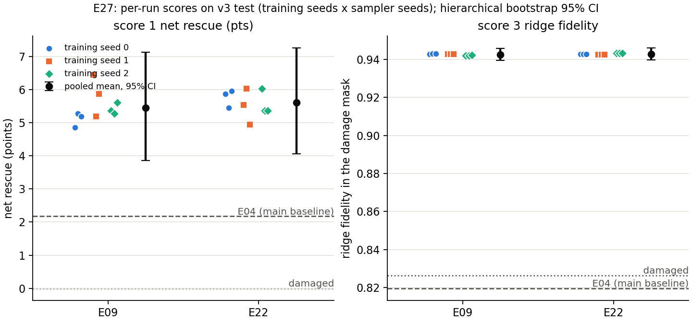

# Experimental log

One entry per experiment, oldest first. Each entry records:

1. **Rationale:** why the experiment was run and what it was expected to show.
2. **Known performance (from the paper):** what the method's paper reports, next to ResShift's numbers
   on a benchmark both report (or a note that no shared benchmark exists).
3. **Our result against E04:** the test results from `evaluation/evaluate.py` (evaluation version 2) on the
   three headline scores, per contaminant, next to the main baseline **E04_msu_stft**, plus the method's
   cost. Generate the table with:
   ```bash
   python evaluation/compare_experiments.py --log-table EXX_short_name --split test
   ```

Results under the old metrics (restoration R, evaluation version 1) are kept in
LEADERBOARD_eval1.md. They are not comparable with the numbers below:
eval 2 normalises every image first and counts events at an operating threshold.

## How to read the results (evaluation version 2)

Every run's `report.md`, section 0, defines each measure from first principles; `evaluation/README.md`
has the same text. In short:

- **Normalisation (temporary; changelog 0019).** Before anything is measured, every image (clean, damaged,
  repaired, gallery) is replaced by the **texture component of MSU's cartoon-texture decomposition**
  (σ 2.5), the first stage of E04. It removes background, brightness and stain shading and keeps the
  ridges, so whole-image enhancers (E03–E05) and paste-back models are measured in the same representation.
  The STFT stage is not applied: that is E04's own method. This will move into the whole pipeline later.
- **Matcher and threshold τ.** Bozorth3 scores a probe against its own gallery print (genuine) and 50
  fixed prints of other fingers (impostors). A comparison is *accepted* when the score exceeds **τ = 23**,
  the score at which 1% of the *clean* probes' impostor comparisons are accepted (FMR 1%). τ is set once
  from clean data and is the same line for every experiment. (It was 21 on un-normalised images; the
  definition, FMR 1% on clean prints, was kept and τ recomputed.)
- **Reference points (all 398 test probes):** accepted at τ, clean 78.9%, damaged 72.4%, so a repair can
  rescue at most about 6.5 points (26 probes) net. FMR damaged 0.89%. Ridge fidelity damaged 0.827. EER
  clean 10.6%, damaged 13.1%.
- **Score 1, identity recovery.** *Rescued* = probes rejected when damaged and accepted after repair;
  *broken* = the reverse. **Net rescue = (rescued − broken) / N**, in points (= acceptance after repair −
  acceptance when damaged). Exact McNemar test of rescued against broken; 95% bootstrap CI.
- **Score 2, false-identity gate.** **ΔFMR = FMR repaired − FMR damaged** at τ. **Pass** when the upper end
  of its 95% CI is below +0.5 points: the repair must be shown not to create matches with strangers.
- **Score 3, ridge fidelity.** Band-pass both images (difference of Gaussians, σ 1 and 4 px), take the
  local correlation with the clean print in an 8 px Gaussian window, average it over the damage mask.
  1 = the true ridges, 0 = unrelated, < 0 = inverted. **Change = repaired − damaged**; Wilcoxon test,
  95% bootstrap CI. Insensitive to brightness and contrast, so restyling the print is not penalised,
  only wrong ridges are.
- **Cost.** Median seconds per print (one print at a time, after warm-up), peak GPU memory and peak RAM,
  from `experiments/benchmark.py` on one A40 node ([benchmark.md](benchmark.md)).
- **Decision rule.** Drop methods that fail score 2; rank the rest by score 1; break ties with score 3,
  then cost.
- **Statistics** (v2: one sample per finger, so probe = finger; the finger-clustered versions used for v3,
  changelog 0021, give identical numbers here). CIs are 95% percentile bootstrap intervals over probes (10,000 resamples; 2,000 for
  EER). Per-contaminant numbers (about 66 probes each) are descriptive only. Between experiments
  (`compare_experiments.py`): every pair, McNemar (score 1) and Wilcoxon (score 3), Holm-adjusted over
  all 55 pairs per score. **Equivalent** when the 90% CI of the difference lies within ±3 points (score 1;
  about 12 probes, the smallest margin 398 probes resolve) or ±0.01 (score 3). That check comes first,
  so a significant but negligible difference counts as equivalent.
- **Table cells** are `this experiment / E04`. *accepted clean / damaged* and *ridge fid. damaged* are
  the same for every experiment.
- **One training seed per model.** The bootstrap covers the choice of test probes, not training
  randomness. Before a final claim, the 1–2 best models (chosen on val) should be retrained with 2–3 seeds.

---

---

## Summary (test, 398 probes, evaluation version 2)

> **Current best (updated 2026-10-25, after E21–E27; v3 test):** **E09_ccdf and E22_ccdf_aux_minutiae_cldice
> are tied** on every score, and E22 is the cheaper of the two (0.43 vs 0.48 s per print). The tie holds across
> seeds (E27: 3 training × 3 sampler seeds each): E22 − E09 is +0.16 points [−0.72, +1.00] on score 1 and
> +0.0002 [−0.0005, +0.0009] on score 3. Both beat E04 and the damaged prints on every seed. E26 (E12 on raw
> prints) joins the tie on both scores but costs more (0.53 s). The v2 summary below predates these runs;
> its "E09 is the best" is now "E09 = E22". Sources: `evaluation/results/comparison/v3/test/comparison.md`,
> `experiments/main/E27_seed_study/results.md`; entries E21–E25, E26 and E27 at the end of this log.

### Against E04, the main baseline

- **Score 2: every method passes the gate.** No repair measurably raises the false-match rate: every ΔFMR CI
  lies within −1.05 to +0.23 points. E03 *raised* impostor scores under eval 1 (un-normalised images).
  Once its ridge map and the gallery are both in texture form, that effect is gone.
- **Score 1: E04 itself is not distinguishable from no repair.** It rescues 20 probes and breaks 14:
  net +1.5 points [−1.3, +4.3], McNemar p = 0.39. Under eval 1 it was +4.3 [+1.3, +7.5]. The
  normalisation is E04's own first stage, so part of what E04 did for matching now happens to every
  input, and its STFT stage adds little on top.
- **No method is significantly better than E04 on score 1 after the Holm adjustment over 55 pairs.**
  The E02 family comes closest: E09 +2.8 points [−0.3, +5.8], E07 and E08 +2.3, E06 +0.5, E02 +1.3.
  The ceiling is low: clean prints are accepted at 78.9% and damaged ones at 72.4%, so the most any
  repair can gain is 6.5 points (26 probes). E09's +4.3 recovers about two-thirds of that.
  - Unadjusted, against the damaged probes alone: E09 (p = 0.003), E08 (0.011) and E07 (0.017)
    rescue significantly more probes than they break; E02 is borderline (0.052); E04 is not (0.39).
    Over all 55 pairs, none of these survives the Holm adjustment (E09 vs damaged: adjusted p = 0.09).
- **Score 3 separates the methods clearly.** E04 leaves the damaged region's ridges where they were
  (ridge fidelity 0.820 vs 0.827 damaged; −0.008, inside the ±0.01 margin, so equivalent to no repair).
  It sharpens what is visible but cannot recover ridges the contaminant hid.
  - The E02 family recovers them: 0.930–0.943, +0.11 to +0.12 over E04, every pair significant.
  - E09 is the best on ridge fidelity, significantly ahead of every other method (+0.011 to +0.013 over
    E02, E06–E08, just past the margin).
  - E10/E11 (one-step CTMSR) score below E04 and below no repair (0.80); E03/E05 destroy the ridges
    (0.55, 0.52).
- **EER** (diagnostic): E04 11.8% (change −1.3 points [−2.7, +0.2]). E06 10.3%, E02 10.9%, E07–E09
  11.2–11.4%, all with CIs of their change below 0.
- **Cost:** E04 is by far the cheapest: 0.22 s per print on 8 CPU threads, 572 MB RAM, no GPU, no
  parameters. E09 needs 0.48 s and 681 MB of GPU memory; E02, E06–E08 about 0.8 s.
- **By the decision rule:** all pass score 2. On score 1, E09, E07 and E08 lead (+4.3, +3.8, +3.8) and are
  equivalent to each other (90% CIs within ±3 points), with E02 equivalent to E07 and E08. Score 3
  breaks the tie in favour of **E09**, which is also the cheapest of the four (0.48 s vs ~0.8 s). Its
  advantage over **E04** on score 1 is not yet established; on score 3 it is large (+0.123).

### All experiments (test)

| experiment | rescued | broken | 1 net rescue, pts (95% CI) | p | 2 FMR change, pts (95% CI) | gate | 3 ridge fidelity | 3 change (95% CI) | EER % | s / print | GPU MB | RAM MB |
|---|---|---|---|---|---|---|---|---|---|---|---|---|
| E02_resshift | 19 | 8 | +2.8 [+0.3, +5.3] | 0.052 | +0.02 [-0.14, +0.18] | pass | 0.930 | +0.103 [+0.095, +0.111] | 10.9 | 0.86 cuda | 678 | 1043 |
| E03_fingergan | 10 | 116 | -26.6 [-31.7, -21.9] | 5e-24 | -0.15 [-0.39, +0.08] | pass | 0.551 | -0.277 [-0.287, -0.267] | 20.8 | 1.16 cuda | 3598 | 1025 |
| **E04_msu_stft** | 20 | 14 | +1.5 [-1.3, +4.3] | 0.392 | +0.05 [-0.13, +0.23] | pass | 0.820 | -0.008 [-0.009, -0.006] | 11.8 | 0.22 cpu | – | 572 |
| E05_msu_aec | 3 | 211 | -52.3 [-57.3, -47.2] | 1e-58 | -0.84 [-1.05, -0.66] | pass | 0.515 | -0.312 [-0.326, -0.298] | 25.8 | 0.26 cuda | 37 | 972 |
| E06_aux_minutiae | 18 | 10 | +2.0 [-0.5, +4.5] | 0.185 | -0.10 [-0.27, +0.08] | pass | 0.931 | +0.104 [+0.096, +0.112] | 10.3 | 0.80 cuda | 678 | 1009 |
| E07_aux_minutiae_cldice | 25 | 10 | +3.8 [+1.0, +6.5] | 0.017 | -0.05 [-0.20, +0.10] | pass | 0.930 | +0.103 [+0.094, +0.111] | 11.3 | 0.83 cuda | 678 | 970 |
| E08_aux_cv_edge_mix | 23 | 8 | +3.8 [+1.0, +6.5] | 0.011 | -0.06 [-0.22, +0.11] | pass | 0.932 | +0.104 [+0.096, +0.113] | 11.4 | 0.83 cuda | 678 | 1036 |
| E09_ccdf | 24 | 7 | +4.3 [+1.8, +7.0] | 0.003 | +0.03 [-0.13, +0.18] | pass | 0.943 | +0.115 [+0.106, +0.125] | 11.2 | 0.48 cuda | 681 | 1011 |
| E10_ctmsr | 8 | 15 | -1.8 [-4.3, +0.5] | 0.210 | +0.01 [-0.15, +0.17] | pass | 0.800 | -0.027 [-0.030, -0.024] | 12.9 | 0.40 cuda | 675 | 1042 |
| E11_ctmsr_dtm | 11 | 18 | -1.8 [-4.5, +0.8] | 0.265 | -0.02 [-0.17, +0.13] | pass | 0.798 | -0.030 [-0.033, -0.027] | 12.8 | 0.40 cuda | 675 | 1019 |

All probes (n = 398). Reference points: accepted at τ: clean 78.9%, damaged 72.4%; FMR damaged 0.89%; ridge fidelity damaged 0.827 (clean = 1); EER damaged 13.1%. p = exact McNemar (rescued vs broken).

### Every pair

Score 1 compares acceptance at τ (exact McNemar), score 3 the ridge fidelity in the mask (Wilcoxon signed-rank), probe by probe. p-values are Holm-adjusted over all 55 pairs, per score. **equivalent**: the 90% CI of the difference lies within ±3 points (score 1) or ±0.01 (score 3), whatever the p-value. **A better / B better**: otherwise, adjusted p < 0.05. **unresolved**: neither. `damaged` = the unrepaired probes. Score 2 is a per-run gate (table above).

**Score 1 (identity recovery)**: row vs column, ▲ row better, ▼ row worse, ≈ equivalent, · unresolved

|  | dmg | E02 | E03 | E04 | E05 | E06 | E07 | E08 | E09 | E10 | E11 |
|---|---|---|---|---|---|---|---|---|---|---|---|
| dmg |  | · | ▲ | · | ▲ | · | · | · | · | · | · |
| E02 | · |  | ▲ | · | ▲ | ≈ | ≈ | ≈ | · | ▲ | · |
| E03 | ▼ | ▼ |  | ▼ | ▲ | ▼ | ▼ | ▼ | ▼ | ▼ | ▼ |
| E04 | · | · | ▲ |  | ▲ | · | · | · | · | · | · |
| E05 | ▼ | ▼ | ▼ | ▼ |  | ▼ | ▼ | ▼ | ▼ | ▼ | ▼ |
| E06 | · | ≈ | ▲ | · | ▲ |  | · | · | · | · | · |
| E07 | · | ≈ | ▲ | · | ▲ | · |  | ≈ | ≈ | ▲ | ▲ |
| E08 | · | ≈ | ▲ | · | ▲ | · | ≈ |  | ≈ | ▲ | ▲ |
| E09 | · | · | ▲ | · | ▲ | · | ≈ | ≈ |  | ▲ | ▲ |
| E10 | · | ▼ | ▲ | · | ▲ | · | ▼ | ▼ | ▼ |  | ≈ |
| E11 | · | · | ▲ | · | ▲ | · | ▼ | ▼ | ▼ | ≈ |  |

**Score 3 (ridge fidelity)**: same reading

|  | dmg | E02 | E03 | E04 | E05 | E06 | E07 | E08 | E09 | E10 | E11 |
|---|---|---|---|---|---|---|---|---|---|---|---|
| dmg |  | ▼ | ▲ | ≈ | ▲ | ▼ | ▼ | ▼ | ▼ | ▲ | ▲ |
| E02 | ▲ |  | ▲ | ▲ | ▲ | ≈ | ≈ | ≈ | ▼ | ▲ | ▲ |
| E03 | ▼ | ▼ |  | ▼ | ▲ | ▼ | ▼ | ▼ | ▼ | ▼ | ▼ |
| E04 | ≈ | ▼ | ▲ |  | ▲ | ▼ | ▼ | ▼ | ▼ | ▲ | ▲ |
| E05 | ▼ | ▼ | ▼ | ▼ |  | ▼ | ▼ | ▼ | ▼ | ▼ | ▼ |
| E06 | ▲ | ≈ | ▲ | ▲ | ▲ |  | ≈ | ≈ | ▼ | ▲ | ▲ |
| E07 | ▲ | ≈ | ▲ | ▲ | ▲ | ≈ |  | ≈ | ▼ | ▲ | ▲ |
| E08 | ▲ | ≈ | ▲ | ▲ | ▲ | ≈ | ≈ |  | ▼ | ▲ | ▲ |
| E09 | ▲ | ▲ | ▲ | ▲ | ▲ | ▲ | ▲ | ▲ |  | ▲ | ▲ |
| E10 | ▼ | ▼ | ▲ | ▼ | ▲ | ▼ | ▼ | ▼ | ▼ |  | ≈ |
| E11 | ▼ | ▼ | ▲ | ▼ | ▲ | ▼ | ▼ | ▼ | ▼ | ≈ |  |

<details><summary>All pairs with differences, CIs and adjusted p-values</summary>

| A | B | 1: A − B, pts (95% CI) | p (Holm) | verdict | 3: A − B (95% CI) | p (Holm) | verdict |
|---|---|---|---|---|---|---|---|
| damaged | E02_resshift | -2.8 [-5.3, -0.3] | 1.000 | unresolved | -0.103 [-0.112, -0.095] | 3e-65 | B better |
| damaged | E03_fingergan | +26.6 [+21.9, +31.7] | 2e-22 | A better | +0.277 [+0.267, +0.286] | 3e-65 | A better |
| damaged | E04_msu_stft | -1.5 [-4.3, +1.3] | 1.000 | unresolved | +0.008 [+0.006, +0.009] | 4e-26 | equivalent |
| damaged | E05_msu_aec | +52.3 [+47.2, +57.3] | 6e-57 | A better | +0.312 [+0.298, +0.326] | 3e-65 | A better |
| damaged | E06_aux_minutiae | -2.0 [-4.5, +0.5] | 1.000 | unresolved | -0.104 [-0.113, -0.096] | 3e-65 | B better |
| damaged | E07_aux_minutiae_cldice | -3.8 [-6.8, -0.8] | 0.417 | unresolved | -0.103 [-0.111, -0.094] | 3e-65 | B better |
| damaged | E08_aux_cv_edge_mix | -3.8 [-6.5, -1.0] | 0.288 | unresolved | -0.104 [-0.113, -0.096] | 1e-64 | B better |
| damaged | E09_ccdf | -4.3 [-7.0, -1.8] | 0.093 | unresolved | -0.115 [-0.125, -0.106] | 3e-65 | B better |
| damaged | E10_ctmsr | +1.8 [-0.5, +4.3] | 1.000 | unresolved | +0.027 [+0.024, +0.030] | 5e-42 | A better |
| damaged | E11_ctmsr_dtm | +1.8 [-0.8, +4.5] | 1.000 | unresolved | +0.030 [+0.027, +0.033] | 2e-47 | A better |
| E02_resshift | E03_fingergan | +29.4 [+24.4, +34.4] | 2e-26 | A better | +0.380 [+0.371, +0.388] | 3e-65 | A better |
| E02_resshift | E04_msu_stft | +1.3 [-1.8, +4.5] | 1.000 | unresolved | +0.111 [+0.102, +0.119] | 3e-65 | A better |
| E02_resshift | E05_msu_aec | +55.0 [+50.0, +60.1] | 2e-61 | A better | +0.415 [+0.403, +0.426] | 3e-65 | A better |
| E02_resshift | E06_aux_minutiae | +0.8 [-1.0, +2.5] | 1.000 | equivalent | -0.001 [-0.002, +0.000] | 3e-12 | equivalent |
| E02_resshift | E07_aux_minutiae_cldice | -1.0 [-3.0, +1.0] | 1.000 | equivalent | +0.000 [-0.001, +0.002] | 7e-06 | equivalent |
| E02_resshift | E08_aux_cv_edge_mix | -1.0 [-3.0, +1.0] | 1.000 | equivalent | -0.002 [-0.003, -0.000] | 1e-20 | equivalent |
| E02_resshift | E09_ccdf | -1.5 [-4.0, +1.0] | 1.000 | unresolved | -0.012 [-0.014, -0.011] | 1e-56 | B better |
| E02_resshift | E10_ctmsr | +4.5 [+1.8, +7.3] | 0.043 | A better | +0.130 [+0.122, +0.139] | 3e-65 | A better |
| E02_resshift | E11_ctmsr_dtm | +4.5 [+1.8, +7.3] | 0.061 | unresolved | +0.133 [+0.124, +0.142] | 3e-65 | A better |
| E03_fingergan | E04_msu_stft | -28.1 [-32.9, -23.4] | 9e-26 | B better | -0.269 [-0.278, -0.260] | 3e-65 | B better |
| E03_fingergan | E05_msu_aec | +25.6 [+20.4, +30.9] | 4e-18 | A better | +0.035 [+0.025, +0.046] | 6e-09 | A better |
| E03_fingergan | E06_aux_minutiae | -28.6 [-33.4, -23.9] | 2e-26 | B better | -0.381 [-0.389, -0.372] | 3e-65 | B better |
| E03_fingergan | E07_aux_minutiae_cldice | -30.4 [-35.4, -25.4] | 3e-28 | B better | -0.380 [-0.388, -0.371] | 3e-65 | B better |
| E03_fingergan | E08_aux_cv_edge_mix | -30.4 [-35.4, -25.4] | 3e-28 | B better | -0.381 [-0.390, -0.373] | 3e-65 | B better |
| E03_fingergan | E09_ccdf | -30.9 [-35.9, -25.9] | 4e-28 | B better | -0.392 [-0.401, -0.383] | 3e-65 | B better |
| E03_fingergan | E10_ctmsr | -24.9 [-29.9, -19.8] | 3e-19 | B better | -0.249 [-0.258, -0.240] | 3e-65 | B better |
| E03_fingergan | E11_ctmsr_dtm | -24.9 [-29.9, -19.8] | 8e-19 | B better | -0.247 [-0.256, -0.238] | 3e-65 | B better |
| E04_msu_stft | E05_msu_aec | +53.8 [+48.7, +58.5] | 6e-60 | A better | +0.305 [+0.290, +0.318] | 3e-65 | A better |
| E04_msu_stft | E06_aux_minutiae | -0.5 [-3.8, +2.8] | 1.000 | unresolved | -0.112 [-0.120, -0.103] | 3e-65 | B better |
| E04_msu_stft | E07_aux_minutiae_cldice | -2.3 [-5.5, +1.0] | 1.000 | unresolved | -0.110 [-0.119, -0.102] | 3e-65 | B better |
| E04_msu_stft | E08_aux_cv_edge_mix | -2.3 [-5.0, +0.5] | 1.000 | unresolved | -0.112 [-0.121, -0.104] | 6e-65 | B better |
| E04_msu_stft | E09_ccdf | -2.8 [-5.8, +0.3] | 1.000 | unresolved | -0.123 [-0.133, -0.114] | 3e-65 | B better |
| E04_msu_stft | E10_ctmsr | +3.3 [+0.3, +6.3] | 1.000 | unresolved | +0.020 [+0.017, +0.023] | 1e-34 | A better |
| E04_msu_stft | E11_ctmsr_dtm | +3.3 [+0.3, +6.3] | 1.000 | unresolved | +0.022 [+0.020, +0.025] | 1e-39 | A better |
| E05_msu_aec | E06_aux_minutiae | -54.3 [-59.3, -49.0] | 3e-59 | B better | -0.416 [-0.428, -0.404] | 3e-65 | B better |
| E05_msu_aec | E07_aux_minutiae_cldice | -56.0 [-61.1, -51.0] | 1e-62 | B better | -0.415 [-0.427, -0.403] | 3e-65 | B better |
| E05_msu_aec | E08_aux_cv_edge_mix | -56.0 [-60.8, -51.0] | 5e-64 | B better | -0.417 [-0.428, -0.405] | 3e-65 | B better |
| E05_msu_aec | E09_ccdf | -56.5 [-61.3, -51.5] | 3e-63 | B better | -0.427 [-0.439, -0.416] | 3e-65 | B better |
| E05_msu_aec | E10_ctmsr | -50.5 [-55.5, -45.5] | 7e-55 | B better | -0.285 [-0.298, -0.271] | 3e-65 | B better |
| E05_msu_aec | E11_ctmsr_dtm | -50.5 [-55.5, -45.5] | 7e-55 | B better | -0.282 [-0.295, -0.268] | 3e-65 | B better |
| E06_aux_minutiae | E07_aux_minutiae_cldice | -1.8 [-4.0, +0.3] | 1.000 | unresolved | +0.001 [+0.000, +0.002] | 6e-09 | equivalent |
| E06_aux_minutiae | E08_aux_cv_edge_mix | -1.8 [-4.0, +0.5] | 1.000 | unresolved | -0.001 [-0.002, +0.001] | 1e-07 | equivalent |
| E06_aux_minutiae | E09_ccdf | -2.3 [-4.5, +0.0] | 1.000 | unresolved | -0.011 [-0.013, -0.010] | 4e-19 | B better |
| E06_aux_minutiae | E10_ctmsr | +3.8 [+1.0, +6.5] | 0.288 | unresolved | +0.131 [+0.123, +0.140] | 3e-65 | A better |
| E06_aux_minutiae | E11_ctmsr_dtm | +3.8 [+1.0, +6.8] | 0.417 | unresolved | +0.134 [+0.125, +0.143] | 3e-65 | A better |
| E07_aux_minutiae_cldice | E08_aux_cv_edge_mix | +0.0 [-2.5, +2.5] | 1.000 | equivalent | -0.002 [-0.003, -0.000] | 8e-16 | equivalent |
| E07_aux_minutiae_cldice | E09_ccdf | -0.5 [-3.0, +2.0] | 1.000 | equivalent | -0.013 [-0.015, -0.010] | 5e-35 | B better |
| E07_aux_minutiae_cldice | E10_ctmsr | +5.5 [+2.8, +8.3] | 0.004 | A better | +0.130 [+0.121, +0.139] | 3e-65 | A better |
| E07_aux_minutiae_cldice | E11_ctmsr_dtm | +5.5 [+2.8, +8.3] | 0.006 | A better | +0.133 [+0.124, +0.142] | 3e-65 | A better |
| E08_aux_cv_edge_mix | E09_ccdf | -0.5 [-2.8, +1.8] | 1.000 | equivalent | -0.011 [-0.013, -0.009] | 6e-17 | B better |
| E08_aux_cv_edge_mix | E10_ctmsr | +5.5 [+2.8, +8.5] | 0.010 | A better | +0.132 [+0.123, +0.141] | 3e-65 | A better |
| E08_aux_cv_edge_mix | E11_ctmsr_dtm | +5.5 [+2.8, +8.5] | 0.010 | A better | +0.134 [+0.125, +0.144] | 3e-65 | A better |
| E09_ccdf | E10_ctmsr | +6.0 [+3.3, +9.0] | 0.003 | A better | +0.143 [+0.133, +0.153] | 3e-65 | A better |
| E09_ccdf | E11_ctmsr_dtm | +6.0 [+3.0, +9.0] | 0.004 | A better | +0.145 [+0.135, +0.156] | 3e-65 | A better |
| E10_ctmsr | E11_ctmsr_dtm | +0.0 [-1.8, +1.8] | 1.000 | equivalent | +0.002 [+0.002, +0.003] | 4e-35 | equivalent |

</details>

Source: `evaluation/results/E02_resshift/test_20261023_134052`, `evaluation/results/E03_fingergan/test_20261023_134615`, `evaluation/results/E04_msu_stft/test_20261023_134805`, `evaluation/results/E05_msu_aec/test_20261023_135018`, `evaluation/results/E06_aux_minutiae/test_20261023_135146`, `evaluation/results/E07_aux_minutiae_cldice/test_20261023_135348`, `evaluation/results/E08_aux_cv_edge_mix/test_20261023_135609`, `evaluation/results/E09_ccdf/test_20261023_135852`, `evaluation/results/E10_ctmsr/test_20261023_140106`, `evaluation/results/E11_ctmsr_dtm/test_20261023_140337`.

### Cost

| experiment | device | s / print (median) | s / print (p90) | peak GPU MB | peak RAM MB | parameters |
|---|---|---|---|---|---|---|
| E02_resshift | NVIDIA A40 | 0.855 | 1.279 | 678 | 1043 | 8,103,937 |
| E03_fingergan | NVIDIA A40 | 1.162 | 1.570 | 3598 | 1025 | 33,867,137 |
| E04_msu_stft | AMD EPYC 7313 16-Core Processor, 8 threads | 0.220 | 0.403 | – | 572 | 0 |
| E05_msu_aec | NVIDIA A40 | 0.260 | 0.405 | 37 | 972 | 647,441 |
| E06_aux_minutiae | NVIDIA A40 | 0.797 | 1.266 | 678 | 1009 | 8,103,937 |
| E07_aux_minutiae_cldice | NVIDIA A40 | 0.830 | 1.272 | 678 | 970 | 8,103,937 |
| E08_aux_cv_edge_mix | NVIDIA A40 | 0.825 | 1.288 | 678 | 1036 | 8,103,937 |
| E09_ccdf | NVIDIA A40 | 0.478 | 0.735 | 681 | 1011 | 8,103,937 |
| E10_ctmsr | NVIDIA A40 | 0.401 | 0.637 | 675 | 1042 | 8,103,937 |
| E11_ctmsr_dtm | NVIDIA A40 | 0.399 | 0.628 | 675 | 1019 | 8,103,937 |

From [benchmark.md](benchmark.md): 50 test prints per method, one at a time, after 3 warm-up calls, on one A40 node (E04 on its CPU).

---

## E01_gabor: classical Gabor enhancement

- **v1 only.** Its v2 run was cancelled on 2026-10-23 (Raheel), so E01 has no v2 or eval-2 result.
- **Folder:** [E01_gabor/](baselines/E01_gabor/). Run: `evaluation/results/E01_gabor/test_20261020_200652`.

### Rationale
The non-learned baseline every model has to beat. Gabor enhancement (Hong, Wan and Jain, TPAMI
1998) takes the ridge orientation and frequency measured outside the damage, fills them into the
damage, and filters with a bank of 16 orientations × 4 frequencies. It needs no training data, has 0
parameters and runs at about 1 s per print on a CPU. Expected weakness: on large blank areas it
draws smooth parallel ridges, which look plausible but are invented detail.

### Known performance (from the paper)
- Hong et al. (1998) evaluate enhancement by the goodness index of the minutiae extracted after
  enhancement and by verification accuracy. They report no PSNR or LPIPS, so the method cannot be
  compared with ResShift on those.
- Their exact numbers are not copied here: the paper's full text could not be checked while writing
  this entry. Fill them in from the paper (IEEE TPAMI 20(8):777–789).

### Our result
No evaluation-version-2 result: E01 was only run on v1 data. Its eval-1 result (restoration R) is in LEADERBOARD_eval1.md.

---

## E02_resshift: ResShift residual-shifting diffusion (reference model)

- **Folder:** [E02_resshift/](main/E02_resshift/). Run: `evaluation/results/E02_resshift/test_20261023_134052`.

### Rationale
Diffusion usually starts from pure noise. ResShift (Yue, Wang and Loy, NeurIPS 2023 / TPAMI 2024)
starts from the damaged image plus noise, and shifts the residual (damaged − clean) towards zero in
15 steps.

- **Why this should suit fingerprints:** the undamaged ridges stay as an anchor, so a few steps and
  a small model (8.1M-parameter pixel-space U-Net) are enough.
- **Orientation input:** a 2-channel orientation field tells the network which way the ridges should
  run inside the damage.
- **Hypothesis:** restore identity (lower EER) without inventing minutiae (no rise in impostor
  scores), unlike Gabor.

Only ResShift's schedule, training target and sampler are re-implemented. Its autoencoder, latent
space, U-Net and weights are not used. Details are in E02_resshift/README.md.

### Known performance (from the paper)
These are the numbers reported in Yue, Wang and Loy, TPAMI 2024 (arXiv 2403.07319). They are on
natural images, not fingerprints. E02 is the reference, so there is no comparison here.

| task (paper table) | model | steps | PSNR ↑ | SSIM ↑ | LPIPS ↓ |
|---|---|---|---|---|---|
| ×4 super-resolution, ImageNet-Test (Table V) | ResShift-15 | 15 | 25.01 | 0.677 | 0.231 |
| ×4 super-resolution, ImageNet-Test (Table V) | ResShiftL-4 | 4 | 25.02 | 0.683 | 0.208 |
| inpainting, ImageNet-Test, mean of 4 mask types (Table VII) | ResShiftL | 4 | not reported | not reported | 0.2298 |
| inpainting, CelebA-Test, mean of 4 mask types (Table VIII) | ResShiftL | 4 | not reported | not reported | 0.1506 |

- **Schedule:** E02 uses the schedule of the 15-step configuration (ResShift-15).
- **Benchmark for later experiments:** ×4 super-resolution on ImageNet-Test is the benchmark with
  PSNR and LPIPS. For inpainting, the paper reports LPIPS only.

### Our result against E04 (test, eval 2; `E02 / E04`)
| contaminant | n | accepted clean / damaged | ridge fid. damaged | rescued | broken | 1 net rescue (pts) | 2 FMR change (pts) | 3 ridge fidelity | 3 change |
|---|---|---|---|---|---|---|---|---|---|
| pressure | 67 | 84% / 84% | 0.959 | 0 / 1 | 1 / 3 | -1.5 / -3.0 | +0.09 / -0.33 | 0.983 / 0.951 | +0.024 / -0.008 |
| scar | 67 | 75% / 67% | 0.774 | 3 / 7 | 2 / 2 | +1.5 / +7.5 | +0.09 / +0.27 | 0.895 / 0.756 | +0.121 / -0.018 |
| oil | 66 | 85% / 79% | 0.937 | 4 / 3 | 0 / 2 | +6.1 / +1.5 | +0.27 / +0.18 | 0.985 / 0.934 | +0.048 / -0.004 |
| sanitizer | 66 | 76% / 71% | 0.954 | 3 / 3 | 3 / 2 | +0.0 / +1.5 | -0.06 / +0.00 | 0.991 / 0.943 | +0.037 / -0.011 |
| mehendi | 66 | 80% / 67% | 0.555 | 7 / 4 | 2 / 2 | +7.6 / +3.0 | -0.09 / +0.03 | 0.797 / 0.547 | +0.242 / -0.008 |
| lotion | 66 | 74% / 67% | 0.783 | 2 / 2 | 0 / 3 | +3.0 / -1.5 | -0.18 / +0.15 | 0.930 / 0.788 | +0.147 / +0.005 |
| **all** | 398 | 79% / 72% | 0.827 | 19 / 20 | 8 / 14 | +2.8 / +1.5 | +0.02 / +0.05 | 0.930 / 0.820 | +0.103 / -0.008 |

Cells: E02_resshift / E04_msu_stft. Source: `evaluation/results/E02_resshift/test_20261023_134052`, `evaluation/results/E04_msu_stft/test_20261023_134805`.

- **Score 1:** rescued 19, broken 8, net **+2.8 points** [+0.3, +5.3], p = 0.052. E04: 20 / 14, +1.5.
  Against E04 +1.3 points [−1.8, +4.5], unresolved. Its gains are on mehendi (+7.6), oil (+6.1) and
  lotion (+3.0), where E04 gains +3.0, +1.5 and −1.5; on scar E04 does better (+7.5 vs +1.5).
- **Score 2:** ΔFMR +0.02 points [−0.14, +0.18], pass.
- **Score 3:** ridge fidelity **0.930** (damaged 0.827), change +0.103 [+0.095, +0.111]; E04 0.820
  (−0.008). +0.111 over E04, significant. Largest on mehendi (0.555 → 0.797) and lotion, where the
  contaminant hides the most ridge.
- **EER** 10.9% (damaged 13.1%; change −2.2 [−3.4, −1.0]); E04 11.8%.
- **Cost:** 0.86 s per print on an A40 (15 network calls per tile), 678 MB GPU, 1.0 GB RAM, 8.1M
  parameters; E04 0.22 s on CPU.

---

## E03_fingergan: FingerGAN, released weights, zero-shot (v2 data)

- **Folder:** [E03_fingergan/](baselines/E03_fingergan/). Run: `evaluation/results/E03_fingergan/test_20261023_134615`.
- **SOTA baseline**, zero-shot: the authors' released weights, no retraining. Whole print, **no paste-back**
  (it ignores the mask and the contaminant type), so pixels outside the damage change too.

### Rationale
FingerGAN (Zhu, Yin & Hu, TPAMI 2023) is the strongest published fingerprint-enhancement model with
public weights.
- **What it is:** a 33.9M-parameter U-Net GAN, trained on **latent** prints, whose output is constrained
  to the clean print's minutia-weighted ridge skeleton and orientation field.
- **Question:** does a SOTA latent enhancer transfer to our live-scan contaminants without retraining?
- **Run as the authors' script does:** texture part of a cartoon-texture decomposition (σ 6), 192 px
  windows every 10 px, outputs averaged. Its output is a ridge map (thin bright valleys on black), not a
  grey print.

### Known performance (from the paper)
- **Matching only:** rank-1 identification on NIST SD27 latents of **59.69%**, against 52.71% for the MSU
  latent AFIS in the same protocol; it also beats MSU on IIIT-Delhi MOLF. All with the commercial
  VeriFinger matcher, not Bozorth3.
- **No PSNR/LPIPS** and no benchmark shared with ResShift, so no direct comparison is possible.

### Our result against E04 (test, eval 2; `E03 / E04`)
| contaminant | n | accepted clean / damaged | ridge fid. damaged | rescued | broken | 1 net rescue (pts) | 2 FMR change (pts) | 3 ridge fidelity | 3 change |
|---|---|---|---|---|---|---|---|---|---|
| pressure | 67 | 84% / 84% | 0.959 | 0 / 1 | 21 / 3 | -31.3 / -3.0 | -0.15 / -0.33 | 0.644 / 0.951 | -0.316 / -0.008 |
| scar | 67 | 75% / 67% | 0.774 | 3 / 7 | 19 / 2 | -23.9 / +7.5 | -0.15 / +0.27 | 0.514 / 0.756 | -0.260 / -0.018 |
| oil | 66 | 85% / 79% | 0.937 | 2 / 3 | 21 / 2 | -28.8 / +1.5 | +0.42 / +0.18 | 0.641 / 0.934 | -0.297 / -0.004 |
| sanitizer | 66 | 76% / 71% | 0.954 | 1 / 3 | 18 / 2 | -25.8 / +1.5 | -0.24 / +0.00 | 0.599 / 0.943 | -0.356 / -0.011 |
| mehendi | 66 | 80% / 67% | 0.555 | 2 / 4 | 21 / 2 | -28.8 / +3.0 | -0.58 / +0.03 | 0.361 / 0.547 | -0.194 / -0.008 |
| lotion | 66 | 74% / 67% | 0.783 | 2 / 2 | 16 / 3 | -21.2 / -1.5 | -0.21 / +0.15 | 0.545 / 0.788 | -0.239 / +0.005 |
| **all** | 398 | 79% / 72% | 0.827 | 10 / 20 | 116 / 14 | -26.6 / +1.5 | -0.15 / +0.05 | 0.551 / 0.820 | -0.277 / -0.008 |

Cells: E03_fingergan / E04_msu_stft. Source: `evaluation/results/E03_fingergan/test_20261023_134615`, `evaluation/results/E04_msu_stft/test_20261023_134805`.

- **Score 1: identity is lost.** Rescued 10, broken **116**: net **−26.6 points** [−31.7, −21.9]
  (E04 +1.5), on every contaminant (−21 to −31). Significantly worse than E04 and than no repair.
- **Score 2:** ΔFMR −0.15 points [−0.39, +0.08], **pass**. Under eval 1 (un-normalised images) it was
  the only method that raised impostor scores; in texture form its ridge maps no longer match strangers.
- **Score 3:** ridge fidelity **0.551** (damaged 0.827, E04 0.820), change −0.277: it re-draws the ridges
  of the whole print, and they are not this finger's.
- **EER** 20.8% (change +7.7 [+5.3, +10.0]).
- **Cost:** 1.16 s per print on an A40, 3.6 GB GPU, 33.9M parameters: the most expensive method here.
- **Reading:** a zero-shot transfer failure, latent → live scan. It says nothing about FingerGAN
  retrained on our data.

---

## E04_msu_stft: MSU-LatentAFIS non-learned enhancement (cartoon-texture + STFT), zero-shot (v2 data)

- **Folder:** [E04_msu_stft/](baselines/E04_msu_stft/). Run: `evaluation/results/E04_msu_stft/test_20261023_134805`.
- **SOTA baseline**, no weights: a Python 3 port of the MSU system's own preprocessing, MIT licence. Whole
  print, **no paste-back**.

### Rationale
The MSU latent AFIS (Cao, Nguyen, Tymoszek & Jain, *End-to-End Latent Fingerprint Search*, TIFS 2020) is
FingerGAN's reference system.
- **Pipeline:** its enhancement is cartoon-texture decomposition (σ 2.5) then STFT band-pass filtering,
  followed by a learned autoencoder.
- **The autoencoder can't be used as released:** its Google Drive folder now returns 404 (changelog 0008).
  So this row is the **non-learned part only**; E05 adds the autoencoder, retrained.
- **Question:** does generic texture + frequency enhancement help matching on our damage?

### Known performance (from the paper)
- **Matching only:** rank-1 **65.7%** on NIST SD27, searching 100,000 rolled prints, with its own matcher
  (FingerGAN's paper reports the MSU system at 52.71% in another protocol).
- No PSNR/LPIPS and no benchmark shared with ResShift. These are full-system numbers; no paper reports
  the STFT stage alone.

### Our result (test, eval 2; `E04` alone)
| contaminant | n | accepted clean / damaged | ridge fid. damaged | rescued | broken | 1 net rescue (pts) | 2 FMR change (pts) | 3 ridge fidelity | 3 change |
|---|---|---|---|---|---|---|---|---|---|
| pressure | 67 | 84% / 84% | 0.959 | 1 | 3 | -3.0 | -0.33 | 0.951 | -0.008 |
| scar | 67 | 75% / 67% | 0.774 | 7 | 2 | +7.5 | +0.27 | 0.756 | -0.018 |
| oil | 66 | 85% / 79% | 0.937 | 3 | 2 | +1.5 | +0.18 | 0.934 | -0.004 |
| sanitizer | 66 | 76% / 71% | 0.954 | 3 | 2 | +1.5 | +0.00 | 0.943 | -0.011 |
| mehendi | 66 | 80% / 67% | 0.555 | 4 | 2 | +3.0 | +0.03 | 0.547 | -0.008 |
| lotion | 66 | 74% / 67% | 0.783 | 2 | 3 | -1.5 | +0.15 | 0.788 | +0.005 |
| **all** | 398 | 79% / 72% | 0.827 | 20 | 14 | +1.5 | +0.05 | 0.820 | -0.008 |

Cells: E04_msu_stft. Source: `evaluation/results/E04_msu_stft/test_20261023_134805`.

- **Score 1:** rescued 20, broken 14, net **+1.5 points** [−1.3, +4.3], p = 0.39: not distinguishable from
  no repair. Best on scar (+7.5, 7 rescued) and mehendi (+3.0); it loses probes on pressure (−3.0) and
  lotion (−1.5).
- **Score 2:** ΔFMR +0.05 points [−0.13, +0.23], pass.
- **Score 3:** ridge fidelity **0.820** vs 0.827 damaged, change −0.008 [−0.009, −0.006]: equivalent to no
  repair (inside the ±0.01 margin). It cleans and sharpens the ridges that are visible but cannot
  supply the ones the contaminant hides.
- **EER** 11.8% (damaged 13.1%; change −1.3 [−2.7, +0.2]).
- **Cost:** 0.22 s per print on 8 CPU threads (AMD EPYC 7313), 572 MB RAM, no GPU, no parameters:
  the cheapest method.
- **Eval 1 vs eval 2:** before normalisation E04's net rescue was +4.3 [+1.3, +7.5]. The normalisation
  is E04's own cartoon-texture stage, so most of its matching gain now applies to every input; the STFT
  stage adds little on top. That is a fair baseline: it is what any method gets for free.

---

## E05_msu_aec: MSU-LatentAFIS enhancement autoencoder, retrained with MSU's recipe (v2 data)

- **Folder:** [E05_msu_aec/](baselines/E05_msu_aec/). Run: `evaluation/results/E05_msu_aec/test_20261023_135018`.
- **SOTA baseline.** The released weights are gone (Drive 404), so MSU's architecture
  (`reconstruction2`, 0.65M parameters) was retrained with **MSU's own recipe**: clean prints with generic
  noise, never our contaminants. 50k steps. Whole print, **no paste-back**.

### Rationale
- **What it is:** the learned stage of the MSU enhancement, on top of E04's STFT input. A small conv
  autoencoder with a 4×4×16 bottleneck and no skip connections.
- **Question:** does a generic learned enhancer (the MSU system's choice) add anything over E04's
  non-learned stage?

### Known performance (from the paper)
As E04: only full-system matching numbers (SD27 rank-1 65.7%); no PSNR/LPIPS, no benchmark shared with
ResShift.

### Our result against E04 (test, eval 2; `E05 / E04`)
| contaminant | n | accepted clean / damaged | ridge fid. damaged | rescued | broken | 1 net rescue (pts) | 2 FMR change (pts) | 3 ridge fidelity | 3 change |
|---|---|---|---|---|---|---|---|---|---|
| pressure | 67 | 84% / 84% | 0.959 | 0 / 1 | 40 / 3 | -59.7 / -3.0 | -1.07 / -0.33 | 0.560 / 0.951 | -0.399 / -0.008 |
| scar | 67 | 75% / 67% | 0.774 | 0 / 7 | 36 / 2 | -53.7 / +7.5 | -0.63 / +0.27 | 0.477 / 0.756 | -0.297 / -0.018 |
| oil | 66 | 85% / 79% | 0.937 | 0 / 3 | 36 / 2 | -54.5 / +1.5 | -0.67 / +0.18 | 0.576 / 0.934 | -0.361 / -0.004 |
| sanitizer | 66 | 76% / 71% | 0.954 | 2 / 3 | 33 / 2 | -47.0 / +1.5 | -0.79 / +0.00 | 0.558 / 0.943 | -0.396 / -0.011 |
| mehendi | 66 | 80% / 67% | 0.555 | 1 / 4 | 37 / 2 | -54.5 / +3.0 | -1.00 / +0.03 | 0.406 / 0.547 | -0.149 / -0.008 |
| lotion | 66 | 74% / 67% | 0.783 | 0 / 2 | 29 / 3 | -43.9 / -1.5 | -0.91 / +0.15 | 0.514 / 0.788 | -0.269 / +0.005 |
| **all** | 398 | 79% / 72% | 0.827 | 3 / 20 | 211 / 14 | -52.3 / +1.5 | -0.84 / +0.05 | 0.515 / 0.820 | -0.312 / -0.008 |

Cells: E05_msu_aec / E04_msu_stft. Source: `evaluation/results/E05_msu_aec/test_20261023_135018`, `evaluation/results/E04_msu_stft/test_20261023_134805`.

- **Score 1:** rescued 3, broken **211**: net **−52.3 points** [−57.3, −47.2], the worst of all methods.
- **Score 2:** ΔFMR −0.84 points [−1.05, −0.66], pass: it lowers *all* scores, impostors included.
- **Score 3:** ridge fidelity **0.515** (E04 0.820), change −0.312. The 4×4 bottleneck with no skip
  connections smooths every print towards one generic ridge pattern and cannot carry the person's
  minutiae.
- **EER** 25.8% (change +12.7 [+10.2, +15.1]).
- **Cost:** 0.26 s per print on an A40, 37 MB GPU, 0.65M parameters.
- **Against E04:** the learned stage on top of E04's STFT destroys what E04 keeps (−53.8 points on
  score 1, −0.305 on score 3).

---

## E06_aux_minutiae: E02 + minutiae-weighted L1 on the predicted clean print (v2 data)

- **Folder:** [E06_aux_minutiae/](ablations/E06_aux_minutiae/). Run: `evaluation/results/E06_aux_minutiae/test_20261023_135146`.
- **Author:** Sarthak's agents (changelogs 0013–0015); entry written by Raheel's agent from the run and
  the experiment's README.

### Rationale
Everything is E02's (network, schedule, v2 data and data order, sampling); only the training loss
differs, so E06 − E02 measures the extra term alone.
- **The term:** a minutiae-weighted L1 on the composite xc = M·x̂₀ + (1 − M)·x₀ inside the damage mask
  grown by 4 px.
  - Pixel weight 1 + 4·w, where w has Gaussian bumps (σ 8 px) at the clean print's MINDTCT minutiae.
  - Applied only at low-noise steps (η_t ≤ 0.5), with λ = 0.22 (≈20% of L_diff at init).
- **Hypothesis:** errors at minutiae cost the matcher most, so weighting them should cut spurious and
  missed minutiae and raise genuine scores.

### Known performance (from the paper)
There is no single source paper; minutia-weighted pixel losses appear in FingerGAN's objective.
No PSNR/LPIPS on a benchmark shared with ResShift exists.

### Our result against E04 (test, eval 2; `E06 / E04`)
| contaminant | n | accepted clean / damaged | ridge fid. damaged | rescued | broken | 1 net rescue (pts) | 2 FMR change (pts) | 3 ridge fidelity | 3 change |
|---|---|---|---|---|---|---|---|---|---|
| pressure | 67 | 84% / 84% | 0.959 | 0 / 1 | 2 / 3 | -3.0 / -3.0 | -0.21 / -0.33 | 0.984 / 0.951 | +0.025 / -0.008 |
| scar | 67 | 75% / 67% | 0.774 | 3 / 7 | 1 / 2 | +3.0 / +7.5 | -0.06 / +0.27 | 0.892 / 0.756 | +0.118 / -0.018 |
| oil | 66 | 85% / 79% | 0.937 | 4 / 3 | 0 / 2 | +6.1 / +1.5 | +0.24 / +0.18 | 0.987 / 0.934 | +0.050 / -0.004 |
| sanitizer | 66 | 76% / 71% | 0.954 | 2 / 3 | 3 / 2 | -1.5 / +1.5 | -0.15 / +0.00 | 0.992 / 0.943 | +0.038 / -0.011 |
| mehendi | 66 | 80% / 67% | 0.555 | 6 / 4 | 1 / 2 | +7.6 / +3.0 | -0.24 / +0.03 | 0.800 / 0.547 | +0.246 / -0.008 |
| lotion | 66 | 74% / 67% | 0.783 | 3 / 2 | 3 / 3 | +0.0 / -1.5 | -0.15 / +0.15 | 0.932 / 0.788 | +0.149 / +0.005 |
| **all** | 398 | 79% / 72% | 0.827 | 18 / 20 | 10 / 14 | +2.0 / +1.5 | -0.10 / +0.05 | 0.931 / 0.820 | +0.104 / -0.008 |

Cells: E06_aux_minutiae / E04_msu_stft. Source: `evaluation/results/E06_aux_minutiae/test_20261023_135146`, `evaluation/results/E04_msu_stft/test_20261023_134805`.

- **Score 1:** rescued 18, broken 10, net **+2.0 points** [−0.5, +4.5], p = 0.19. Against E04 +0.5,
  unresolved; equivalent to E02 (+0.8 [−1.0, +2.5] to E02). Gains on mehendi (+7.6) and oil (+6.1).
- **Score 2:** ΔFMR −0.10 points [−0.27, +0.08], pass.
- **Score 3:** ridge fidelity **0.931**, change +0.104; +0.112 over E04. Equivalent to E02 (+0.001).
- **EER** 10.3%, the lowest of all runs (change −2.8 [−4.3, −1.4]); E04 11.8%. EER is a diagnostic here,
  and the headline scores do not separate E06 from E02.
- **Cost:** 0.80 s per print on an A40, 678 MB GPU, 8.1M parameters (E02's network).
- **Reading:** the minutiae-weighted term has no measurable effect on any headline score.

---

## E07_aux_minutiae_cldice: E06 + clDice on soft ridge skeletons (v2 data)

- **Folder:** [E07_aux_minutiae_cldice/](main/E07_aux_minutiae_cldice/). Run: `evaluation/results/E07_aux_minutiae_cldice/test_20261023_135348`.
- **Author:** Sarthak's agents (changelog 0014); entry written by Raheel's agent from the run and the
  README.

### Rationale
E07 is E06 plus one term, with the same minutiae λ (0.22): **E07 − E06 isolates clDice**.
- **The term:** clDice (Shit et al., CVPR 2021) on soft ridge maps (local-mean contrast, τ 0.05) and their
  soft skeletons (4 iterations). λ = 0.19, at the same low-noise gate.
- **Hypothesis:** pixel losses ignore one-pixel breaks and bridges that create spurious minutiae; clDice
  penalises broken or merged ridges directly.
- **Caveat:** both maps are soft, so the term is not 0 at the clean print (0.07 on average). It also pulls
  towards slightly crisper ridges (changelog 0014).

### Known performance (from the paper)
Shit et al. evaluate segmentation of tubular structures (vessels, roads, neurons) with Dice, clDice and
Betti errors, not image restoration. No PSNR/LPIPS on a benchmark shared with ResShift.

### Our result against E04 (test, eval 2; `E07 / E04`)
| contaminant | n | accepted clean / damaged | ridge fid. damaged | rescued | broken | 1 net rescue (pts) | 2 FMR change (pts) | 3 ridge fidelity | 3 change |
|---|---|---|---|---|---|---|---|---|---|
| pressure | 67 | 84% / 84% | 0.959 | 0 / 1 | 1 / 3 | -1.5 / -3.0 | -0.09 / -0.33 | 0.984 / 0.951 | +0.025 / -0.008 |
| scar | 67 | 75% / 67% | 0.774 | 3 / 7 | 0 / 2 | +4.5 / +7.5 | -0.03 / +0.27 | 0.887 / 0.756 | +0.113 / -0.018 |
| oil | 66 | 85% / 79% | 0.937 | 3 / 3 | 0 / 2 | +4.5 / +1.5 | +0.09 / +0.18 | 0.987 / 0.934 | +0.049 / -0.004 |
| sanitizer | 66 | 76% / 71% | 0.954 | 4 / 3 | 4 / 2 | +0.0 / +1.5 | +0.00 / +0.00 | 0.991 / 0.943 | +0.037 / -0.011 |
| mehendi | 66 | 80% / 67% | 0.555 | 10 / 4 | 2 / 2 | +12.1 / +3.0 | -0.03 / +0.03 | 0.802 / 0.547 | +0.247 / -0.008 |
| lotion | 66 | 74% / 67% | 0.783 | 5 / 2 | 3 / 3 | +3.0 / -1.5 | -0.24 / +0.15 | 0.931 / 0.788 | +0.147 / +0.005 |
| **all** | 398 | 79% / 72% | 0.827 | 25 / 20 | 10 / 14 | +3.8 / +1.5 | -0.05 / +0.05 | 0.930 / 0.820 | +0.103 / -0.008 |

Cells: E07_aux_minutiae_cldice / E04_msu_stft. Source: `evaluation/results/E07_aux_minutiae_cldice/test_20261023_135348`, `evaluation/results/E04_msu_stft/test_20261023_134805`.

- **Score 1:** rescued 25 (the most of any method), broken 10, net **+3.8 points** [+1.0, +6.5],
  p = 0.017. Against E04 +2.3 [−1.0, +5.5], unresolved after Holm. Equivalent to E02, E08 and E09.
  Best on mehendi (+12.1, 10 rescued; E04 +3.0).
- **Score 2:** ΔFMR −0.05 points [−0.20, +0.10], pass.
- **Score 3:** ridge fidelity **0.930**, change +0.103; +0.110 over E04. Equivalent to E02 and E06.
- **EER** 11.3% (change −1.8 [−3.2, −0.5]).
- **Cost:** 0.83 s per print on an A40, 678 MB GPU, 8.1M parameters.
- **Against E06 (clDice alone):** +1.8 points on score 1 [−0.3, +4.0], unresolved;
  score 3 equivalent. No sign of the feared over-sharpening.

---

## E08_aux_cv_edge_mix: E02 + Laplacian edge term + MS-SSIM/L1 mix (v2 data)

- **Folder:** [E08_aux_cv_edge_mix/](ablations/E08_aux_cv_edge_mix/). Run: `evaluation/results/E08_aux_cv_edge_mix/test_20261023_135609`.
- **Author:** Sarthak's agents (changelog 0015); entry written by Raheel's agent from the run and the
  README.

### Rationale
Everything is E02's except two extra terms inside the dilated damage mask, at the same low-noise gate.
There is no minutiae term, so E08 − E02 measures these two alone.
- **Edge term:** Charbonnier distance between 4-neighbour Laplacian edge maps, λ 0.27.
- **MS-SSIM/L1 mix:** 0.84·(1 − MS-SSIM) + 0.16·L1, λ 0.12 (α from Zhao et al.).
- **Hypothesis:** MSE favours blurred ridges when the model is unsure. Edge and structure terms
  should give sharper, better-placed ridge walls.

### Known performance (from the paper)
Zhao, Gallo, Frosio & Kautz (*Loss Functions for Image Restoration with Neural Networks*, IEEE TCI 2017)
show that MS-SSIM + L1 beats L2 for restoration. Their results are on their own joint
denoising + demosaicking, super-resolution and JPEG-deblocking sets, not ImageNet ×4 SR, so there is no
benchmark shared with ResShift. Their numbers are not copied here.

### Our result against E04 (test, eval 2; `E08 / E04`)
| contaminant | n | accepted clean / damaged | ridge fid. damaged | rescued | broken | 1 net rescue (pts) | 2 FMR change (pts) | 3 ridge fidelity | 3 change |
|---|---|---|---|---|---|---|---|---|---|
| pressure | 67 | 84% / 84% | 0.959 | 0 / 1 | 1 / 3 | -1.5 / -3.0 | -0.15 / -0.33 | 0.985 / 0.951 | +0.025 / -0.008 |
| scar | 67 | 75% / 67% | 0.774 | 4 / 7 | 1 / 2 | +4.5 / +7.5 | -0.09 / +0.27 | 0.891 / 0.756 | +0.117 / -0.018 |
| oil | 66 | 85% / 79% | 0.937 | 6 / 3 | 0 / 2 | +9.1 / +1.5 | +0.15 / +0.18 | 0.988 / 0.934 | +0.050 / -0.004 |
| sanitizer | 66 | 76% / 71% | 0.954 | 2 / 3 | 3 / 2 | -1.5 / +1.5 | -0.09 / +0.00 | 0.992 / 0.943 | +0.038 / -0.011 |
| mehendi | 66 | 80% / 67% | 0.555 | 8 / 4 | 2 / 2 | +9.1 / +3.0 | -0.09 / +0.03 | 0.802 / 0.547 | +0.247 / -0.008 |
| lotion | 66 | 74% / 67% | 0.783 | 3 / 2 | 1 / 3 | +3.0 / -1.5 | -0.06 / +0.15 | 0.933 / 0.788 | +0.150 / +0.005 |
| **all** | 398 | 79% / 72% | 0.827 | 23 / 20 | 8 / 14 | +3.8 / +1.5 | -0.06 / +0.05 | 0.932 / 0.820 | +0.104 / -0.008 |

Cells: E08_aux_cv_edge_mix / E04_msu_stft. Source: `evaluation/results/E08_aux_cv_edge_mix/test_20261023_135609`, `evaluation/results/E04_msu_stft/test_20261023_134805`.

- **Score 1:** rescued 23, broken 8, net **+3.8 points** [+1.0, +6.5], p = 0.011. Against E04 +2.3
  [−0.5, +5.0], unresolved after Holm. Equivalent to E02, E07 and E09. Gains on oil and mehendi (+9.1
  each).
- **Score 2:** ΔFMR −0.06 points [−0.22, +0.11], pass.
- **Score 3:** ridge fidelity **0.932**, change +0.104; +0.112 over E04. Equivalent to E02, E06 and E07.
- **EER** 11.4% (change −1.7 [−2.9, −0.6]).
- **Cost:** 0.83 s per print on an A40, 678 MB GPU, 8.1M parameters.
- **Reading:** the edge and MS-SSIM/L1 terms leave every score equivalent to E02's.

---

## E09_ccdf: CCDF warm start for E02, with a regression control (v2 data)

- **Folder:** [E09_ccdf/](main/E09_ccdf/). Run: `evaluation/results/E09_ccdf/test_20261023_135852`.
- **Data version v2.**

### Rationale
CCDF (Chung, Sim & Ye, CVPR 2022) argues that a reverse chain need not start from noise.
- **Method:** forward-diffuse a starting estimate x̂₀ to t₀ < T in one jump, then run the reverse chain;
  the contraction shrinks the starting error.
- **Expected effect:** the better x̂₀ is, the smaller t₀ can be, and the less room the sampler has to
  invent detail.
- **Model:** E02's v2 model is used unchanged. Only its sampler is changed.
- **Starting estimates compared:**
  - a deterministic regression U-Net (E02's backbone, L1, 30k steps);
  - E02's own one-call x₀ estimate;
  - the damaged print.
- **Grid:** t₀ ∈ {2, 4, 8, 11}, CCDF's data-consistency projection on or off.
- **Selection** on val, by a rule fixed before the run (`params.json`).

### Known performance (from the paper)
- CCDF reports no PSNR/LPIPS on a benchmark shared with ResShift.
  - Its SR experiments use FFHQ/AFHQ ×4–×8 with FID; its MRI results report PSNR/SSIM.
  - **No direct comparison with ResShift is possible.**
- In the paper, FID is best at t₀ = 0.1–0.5 of the chain, never at the full chain (its Table 2).
- MRI reconstruction works down to t₀ = 0.02 with a neural-network starting estimate (its Table 5).

### Val sweep (197 probes; `E09_ccdf/checkpoints/sweep.csv`)
- **The landscape is nearly flat.**
  - Every configuration starting from the regressor or from E02's estimate lands at a mean genuine score of
    42.5–43.6 and a val EER of 15.3–16.7%.
  - Plain E02 (y₀, t₀ = 15): 42.6 / 15.3%.
  - The regressor alone (t₀ = 0): 43.2 / 15.6%.
- **Only the damaged print with a small t₀ is clearly worse** (genuine 40.3–41.7): its starting error is too
  large for 2–4 steps to contract.
- Impostor p95 is 14 for every configuration.
- **Selected:** E02's one-call estimate, t₀ = 2, projection on (genuine 43.5, EER 16.0%).
  E02 one-call at t₀ = 4 had a higher genuine score (43.6) but failed the EER guard (16.5% > 15.3% + 1 point).

### Our result against E04 (test, eval 2; `E09 / E04`)
| contaminant | n | accepted clean / damaged | ridge fid. damaged | rescued | broken | 1 net rescue (pts) | 2 FMR change (pts) | 3 ridge fidelity | 3 change |
|---|---|---|---|---|---|---|---|---|---|
| pressure | 67 | 84% / 84% | 0.959 | 0 / 1 | 1 / 3 | -1.5 / -3.0 | +0.03 / -0.33 | 0.985 / 0.951 | +0.026 / -0.008 |
| scar | 67 | 75% / 67% | 0.774 | 2 / 7 | 0 / 2 | +3.0 / +7.5 | +0.03 / +0.27 | 0.913 / 0.756 | +0.139 / -0.018 |
| oil | 66 | 85% / 79% | 0.937 | 6 / 3 | 0 / 2 | +9.1 / +1.5 | +0.36 / +0.18 | 0.986 / 0.934 | +0.049 / -0.004 |
| sanitizer | 66 | 76% / 71% | 0.954 | 3 / 3 | 2 / 2 | +1.5 / +1.5 | -0.03 / +0.00 | 0.991 / 0.943 | +0.037 / -0.011 |
| mehendi | 66 | 80% / 67% | 0.555 | 9 / 4 | 1 / 2 | +12.1 / +3.0 | -0.03 / +0.03 | 0.841 / 0.547 | +0.286 / -0.008 |
| lotion | 66 | 74% / 67% | 0.783 | 4 / 2 | 3 / 3 | +1.5 / -1.5 | -0.21 / +0.15 | 0.939 / 0.788 | +0.156 / +0.005 |
| **all** | 398 | 79% / 72% | 0.827 | 24 / 20 | 7 / 14 | +4.3 / +1.5 | +0.03 / +0.05 | 0.943 / 0.820 | +0.115 / -0.008 |

Cells: E09_ccdf / E04_msu_stft. Source: `evaluation/results/E09_ccdf/test_20261023_135852`, `evaluation/results/E04_msu_stft/test_20261023_134805`.

- **Score 1:** rescued 24, broken 7 (the fewest of the paste-back models), net **+4.3 points**
  [+1.8, +7.0], p = 0.003: the highest net rescue, about two-thirds of the 6.5 points a repair can gain.
  Against E04 +2.8 [−0.3, +5.8], unresolved after Holm. Equivalent to E07 and E08; against E02 +1.5,
  unresolved. Best on mehendi (+12.1) and oil (+9.1).
- **Score 2:** ΔFMR +0.03 points [−0.13, +0.18], pass.
- **Score 3:** ridge fidelity **0.943**, change +0.115 [+0.106, +0.125]: **the best of all methods**,
  significantly ahead of every other one (+0.012 over E02) and +0.123 over E04. Mehendi gains the most
  (0.555 → 0.841).
- **EER** 11.2% (change −1.9 [−3.4, −0.4]).
- **Cost:** 0.48 s per print on an A40 (3 network calls per tile instead of 15), 681 MB GPU, 8.1M
  parameters: about 60% of E02's time. Tiling and the orientation field dominate the rest.
- **By the decision rule** E09 is the current best: it passes the gate, ties for the lead on score 1 and
  wins the tie on score 3, at the lowest cost of the leaders.
- The regression control alone (t₀ = 0) was within noise of E02 on val and was not run on test. If the
  report needs it as a row, a test run of `regressor_t0` is cheap.

---

## E10_ctmsr: CTMSR Stage 1, one-step consistency training (v2 data)

- **Folder:** [E10_ctmsr/](one_step/E10_ctmsr/). Run: `evaluation/results/E10_ctmsr/test_20261023_140106`.
- **Data version v2.**

### Rationale
CTMSR (You et al., ICCV 2025) trains a **one-step** model with no teacher. Consistency training on a
ResShift-style trajectory (x_t = x₀ + α(t)e₀ + σ(t)ε) teaches it to map any point of the trajectory to x₀.
It tests the brief's question: **does step count matter for matching, or only for speed?**
- **Backbone:** E02's 8.1M U-Net and inputs, so only the training method differs.
- **Distance:** d = 0.5 LPIPS-VGG + 0.5 Charbonnier.
- **Budget:** 50k steps at lr 1e-4; the paper uses 500K at 5e-5.

### Known performance (from the paper)
×4 SR on ImageNet-Test (CTMSR Table 1), the benchmark ResShift also reports:

| model | steps | PSNR ↑ | LPIPS ↓ |
|---|---|---|---|
| ResShift-15 (as listed in CTMSR's Table 1) | 15 | 24.94 | 0.237 |
| CTMSR-1 (with DTM) | 1 | 24.73 | 0.197 |
| CTMSR-1 without DTM (Table 4) | 1 | 24.71 | 0.200 |

Fidelity is about equal to ResShift's, and perceptual quality is better, at 1 step instead of 15.

### Our result against E04 (test, eval 2; `E10 / E04`)
| contaminant | n | accepted clean / damaged | ridge fid. damaged | rescued | broken | 1 net rescue (pts) | 2 FMR change (pts) | 3 ridge fidelity | 3 change |
|---|---|---|---|---|---|---|---|---|---|
| pressure | 67 | 84% / 84% | 0.959 | 0 / 1 | 3 / 3 | -4.5 / -3.0 | -0.12 / -0.33 | 0.923 / 0.951 | -0.036 / -0.008 |
| scar | 67 | 75% / 67% | 0.774 | 2 / 7 | 1 / 2 | +1.5 / +7.5 | +0.06 / +0.27 | 0.731 / 0.756 | -0.043 / -0.018 |
| oil | 66 | 85% / 79% | 0.937 | 1 / 3 | 3 / 2 | -3.0 / +1.5 | +0.12 / +0.18 | 0.911 / 0.934 | -0.026 / -0.004 |
| sanitizer | 66 | 76% / 71% | 0.954 | 0 / 3 | 3 / 2 | -4.5 / +1.5 | +0.03 / +0.00 | 0.921 / 0.943 | -0.033 / -0.011 |
| mehendi | 66 | 80% / 67% | 0.555 | 3 / 4 | 2 / 2 | +1.5 / +3.0 | +0.03 / +0.03 | 0.509 / 0.547 | -0.046 / -0.008 |
| lotion | 66 | 74% / 67% | 0.783 | 2 / 2 | 3 / 3 | -1.5 / -1.5 | -0.06 / +0.15 | 0.804 / 0.788 | +0.020 / +0.005 |
| **all** | 398 | 79% / 72% | 0.827 | 8 / 20 | 15 / 14 | -1.8 / +1.5 | +0.01 / +0.05 | 0.800 / 0.820 | -0.027 / -0.008 |

Cells: E10_ctmsr / E04_msu_stft. Source: `evaluation/results/E10_ctmsr/test_20261023_140106`, `evaluation/results/E04_msu_stft/test_20261023_134805`.

- **Score 1:** rescued 8, broken 15, net **−1.8 points** [−4.3, +0.5], p = 0.21. Against E04 −3.3
  [−6.3, −0.3], unresolved after Holm; significantly below E02, E07, E08 and E09.
- **Score 2:** ΔFMR +0.01 points [−0.15, +0.17], pass: it invents no matches, it just restores nothing.
- **Score 3:** ridge fidelity **0.800**, change −0.027: below no repair and below E04 (0.820), on every
  contaminant except lotion.
- **EER** 12.9% (change −0.2 [−1.6, +1.1]).
- **Cost:** 0.40 s per print on an A40 (1 network call per tile), 675 MB GPU, 8.1M parameters. The one-step
  model saves only half of E02's time, because tiling and the orientation field dominate.
- **Probably undertrained:** 50k steps, 10% of the paper's budget, with the one-step val L1 still falling
  (0.290 at 5k → 0.198 at 50k). This run does not show that one step can't work.

---

## E11_ctmsr_dtm: CTMSR Stage 2, E10 + Distribution Trajectory Matching (v2 data)

- **Folder:** [E11_ctmsr_dtm/](one_step/E11_ctmsr_dtm/). Run: `evaluation/results/E11_ctmsr_dtm/test_20261023_140337`.
  Data version v2; compared with E04 and above all with **E10** (E11 − E10 isolates DTM).
- Planned as "E10b"; experiment names must match `^E\d{2}_`.

### Rationale
DTM is CTMSR's realism push. A frozen copy of the model defines two PF-ODE trajectories, one from the
noised output and one from the noised ground truth; the output is pushed so that the two agree. In the
paper it raises perceptual scores while PSNR stays flat. **The question here:** does a realism push
invent minutiae, i.e. raise impostor scores?
- **Settings:** the paper's. 2,000 iterations from E10, lr 5e-5, weight 1.6, σ = α = 1/3, frozen copy
  refreshed every 1,000 iterations, plus the CT loss.

### Known performance (from the paper)
CTMSR Table 4, ImageNet-Test, ×4 SR: without DTM PSNR 24.71 / LPIPS 0.2004 / CLIPIQA 0.609 / MUSIQ 56.65;
with DTM 24.73 / 0.1969 / 0.691 / 60.14. ResShift-15 (CTMSR Table 1): 24.94 / 0.237.

### Our result against E04 (test, eval 2; `E11 / E04`)
| contaminant | n | accepted clean / damaged | ridge fid. damaged | rescued | broken | 1 net rescue (pts) | 2 FMR change (pts) | 3 ridge fidelity | 3 change |
|---|---|---|---|---|---|---|---|---|---|
| pressure | 67 | 84% / 84% | 0.959 | 0 / 1 | 2 / 3 | -3.0 / -3.0 | -0.09 / -0.33 | 0.922 / 0.951 | -0.038 / -0.008 |
| scar | 67 | 75% / 67% | 0.774 | 2 / 7 | 2 / 2 | +0.0 / +7.5 | -0.15 / +0.27 | 0.731 / 0.756 | -0.042 / -0.018 |
| oil | 66 | 85% / 79% | 0.937 | 2 / 3 | 5 / 2 | -4.5 / +1.5 | +0.06 / +0.18 | 0.909 / 0.934 | -0.028 / -0.004 |
| sanitizer | 66 | 76% / 71% | 0.954 | 2 / 3 | 4 / 2 | -3.0 / +1.5 | +0.18 / +0.00 | 0.917 / 0.943 | -0.037 / -0.011 |
| mehendi | 66 | 80% / 67% | 0.555 | 3 / 4 | 2 / 2 | +1.5 / +3.0 | +0.12 / +0.03 | 0.506 / 0.547 | -0.049 / -0.008 |
| lotion | 66 | 74% / 67% | 0.783 | 2 / 2 | 3 / 3 | -1.5 / -1.5 | -0.24 / +0.15 | 0.799 / 0.788 | +0.016 / +0.005 |
| **all** | 398 | 79% / 72% | 0.827 | 11 / 20 | 18 / 14 | -1.8 / +1.5 | -0.02 / +0.05 | 0.798 / 0.820 | -0.030 / -0.008 |

Cells: E11_ctmsr_dtm / E04_msu_stft. Source: `evaluation/results/E11_ctmsr_dtm/test_20261023_140337`, `evaluation/results/E04_msu_stft/test_20261023_134805`.

- **Score 1:** rescued 11, broken 18, net **−1.8 points** [−4.5, +0.8]. Equivalent to E10 (+0.0
  [−1.8, +1.8]); against E04 −3.3, unresolved.
- **Score 2:** ΔFMR −0.02 points [−0.17, +0.13], pass: the realism push invents no matches.
- **Score 3:** ridge fidelity **0.798**, change −0.030; E10 0.800. The 0.002 difference is significant but
  inside the margin, so equivalent.
- **EER** 12.8% (change −0.3 [−1.9, +1.0]).
- **Cost:** 0.40 s per print, as E10.
- **Reading:** at the paper's 2k-iteration budget DTM changes nothing measurable; the CTMSR result rests
  on Stage 1 (E10).

---

## E12_norm_ccdf_cldice_cv: clDice + edge + MS-SSIM/L1 ResShift on normalised prints, CCDF sampling (v3 data)

- **Folder:** [E12_norm_ccdf_cldice_cv/](ablations/E12_norm_ccdf_cldice_cv/). Chain job 361858 (calibrate → train → CCDF
  val sweep → test → cost → evaluation); data job 361818.
- **Data version v3** (changelog 0020): v2's damage, 3 damaged copies of every val/test print (3 different
  contaminants) and of every train crop and contaminant. Test: 1,194 samples of 398 fingers.
  **Its numbers are only comparable with v3 runs:** E04 and E09, re-run unchanged on v3 test
  (`experiments/eval_v3.sh`, job 361821).

### Rationale
A "best combination" run, built from the eval-2 results:
- E07 and E08 led on score 1 and were equivalent to each other and to E09.
- E09 (CCDF) led on score 3 and was the cheapest of the leaders.
- E06's minutiae term had no measurable effect, so it is dropped.

What E12 does:
- **Losses:** E02's ResShift with E07's clDice and E08's edge and MS-SSIM/L1 terms. Each λ is calibrated
  to ~20% of L_diff at init, as E07 and E08 did.
- **Sampling:** E09's CCDF, with start, t₀ and projection chosen on v3 val.
- **Normalised domain:** the model works on **MSU-normalised prints**, in training, val and test, so
  it never has to undo stain shading and brightness. It is measured in the representation the evaluator
  uses. Its output is a normalised print, compared as stored with the normalised original and gallery.
- **More data:** 3× the damaged train samples (113,544).

**Caveat:** losses, data, domain and sampler all change at once. E12 can show whether the combination beats
E04 and E09; it cannot say which change did it.

### Known performance (from the paper)
No single source paper; see E07 (clDice), E08 (Zhao et al.) and E09 (CCDF). None reports PSNR/LPIPS on a
benchmark shared with ResShift.

### Val sweep (591 samples; `E12_norm_ccdf_cldice_cv/checkpoints/sweep.csv`)
- **Selected:** the model's one-call estimate, t₀ = 2, no projection. Val acceptance at τ 66.7%, FMR 0.62%,
  mean genuine 43.5, EER 15.0%.
- The plain 15-step chain from y₀: 65.3%, FMR 0.64%, genuine 43.1, EER 15.4%. As in E09, every one-call
  start lands within about one point of it.

### Our result against E04 (test, eval 2, v3; `E12 / E04`)
| contaminant | n | accepted clean / damaged | ridge fid. damaged | rescued | broken | 1 net rescue (pts) | 2 FMR change (pts) | 3 ridge fidelity | 3 change |
|---|---|---|---|---|---|---|---|---|---|
| pressure | 198 | 79% / 78% | 0.961 | 4 / 6 | 3 / 12 | +0.5 / -3.0 | +0.04 / -0.03 | 0.982 / 0.951 | +0.021 / -0.010 |
| scar | 192 | 79% / 75% | 0.776 | 7 / 11 | 2 / 6 | +2.6 / +2.6 | -0.28 / +0.21 | 0.876 / 0.759 | +0.100 / -0.017 |
| oil | 188 | 79% / 70% | 0.933 | 20 / 13 | 4 / 5 | +8.5 / +4.3 | -0.31 / -0.18 | 0.980 / 0.930 | +0.047 / -0.004 |
| sanitizer | 202 | 81% / 76% | 0.955 | 12 / 16 | 9 / 10 | +1.5 / +3.0 | -0.04 / -0.01 | 0.988 / 0.943 | +0.033 / -0.011 |
| mehendi | 193 | 80% / 71% | 0.563 | 18 / 11 | 5 / 7 | +6.7 / +2.1 | +0.11 / -0.09 | 0.817 / 0.556 | +0.254 / -0.006 |
| lotion | 221 | 76% / 60% | 0.772 | 33 / 17 | 5 / 8 | +12.7 / +4.1 | -0.27 / -0.13 | 0.923 / 0.778 | +0.151 / +0.006 |
| **all** | 1194 | 79% / 71% | 0.826 | 94 / 74 | 28 / 48 | +5.5 / +2.2 | -0.13 / -0.04 | 0.928 / 0.820 | +0.102 / -0.007 |

Cells: E12_norm_ccdf_cldice_cv / E04_msu_stft. Source: `evaluation/results/E12_norm_ccdf_cldice_cv/test_20261023_235228`, `evaluation/results/E04_msu_stft/test_20261023_180254`.

- **Score 1:** rescued 94, broken 28, net **+5.5 points** [+3.8, +7.4], p = 3e-09 (finger-level sign-flip).
  - Against E04: +3.4 [+1.3, +5.3], unresolved after Holm (adjusted p 0.10).
  - Against E09 (v3: +5.3): −0.3 [−1.5, +1.0], equivalent.
  - Largest gains on lotion (+12.7) and oil (+8.5).
- **Score 2:** ΔFMR −0.13 points [−0.23, −0.02], pass.
- **Score 3:** ridge fidelity **0.928**, change +0.102 [+0.098, +0.106]. That is +0.108 over E04, but
  **0.015 below E09** (0.943; significant, past the ±0.01 margin). Equivalent to E02, E06–E08 and E16.
- **EER** 10.5%, the lowest on v3 (damaged 12.9%).
- **Cost:** 0.58 s per print on an A40, 682 MB GPU, 8.1M parameters (normalising the input adds ~0.1 s
  over E09).
- **Reading:** the combination did not beat E09. It ties E09 on score 1 and loses to it on score 3, at a
  higher cost. Which of its four changes is responsible is what E13–E16 test.

---

## E13–E16: E12's loss ablations (v3 data)

- **Folders:** [E13_norm_no_cldice/](ablations/E13_norm_no_cldice/), [E14_norm_no_edge/](ablations/E14_norm_no_edge/),
  [E15_norm_no_mix/](ablations/E15_norm_no_mix/), [E16_norm_no_aux/](ablations/E16_norm_no_aux/). Jobs in changelog 0024.
- **One change each against E12: the set of extra loss terms.** The kept terms keep E12's calibrated λs
  (clDice 0.38, edge 0.26, MS-SSIM/L1 mix 0.24; not recalibrated). Data (normalised v3), seed, data
  order, 100k steps, network, schedule, gate, CCDF grid and selection rule are E12's; `train.py` is E12's
  byte for byte and `ccdf_sweep.py` differs only in its import (tests in each folder).

| exp | terms kept | E12 − EXX isolates |
|---|---|---|
| E13_norm_no_cldice | edge, mix | clDice |
| E14_norm_no_edge | clDice, mix | the Laplacian edge term |
| E15_norm_no_mix | clDice, edge | the MS-SSIM/L1 mix |
| E16_norm_no_aux | none (L_diff only) | all three terms; E16 vs E09 also shows what normalised v3 training does |

### Rationale
E12 combines three extra terms. If E12 is the best model, each term should be kept only if removing it
costs something measurable on score 1 or score 3. Each ablation also gets its own CCDF val selection, so
the comparison is between complete methods, as they would be deployed.

### Known performance (from the paper)
Not applicable (ablations of E12).

### Val sweeps (591 samples; each folder's `checkpoints/sweep.csv`)
| exp | selected start, t₀, projection | val accept at τ | val genuine mean | val EER |
|---|---|---|---|---|
| E12 (reference) | one-call, 2, off | 66.7% | 43.5 | 15.0% |
| E13 | **plain chain** (y₀, 15) | 65.8% | 43.3 | 15.3% |
| E14 | **plain chain** (y₀, 15) | 66.2% | 43.1 | 15.3% |
| E16 | one-call, 2, on | 66.0% | 43.4 | 14.8% |

**E13 and E14 picked the full 15-step chain**: on their val sweeps no CCDF start beat it. So they differ
from E12 in the sampler too, and their cost doubles. On v2, CCDF (E09) gained +0.012 ridge fidelity over the
plain chain (E02), so part of the E12 − E13 and E12 − E14 gaps below may be the sampler, not the loss.

### Our result against E12 (test, eval 2, v3)
| exp | rescued / broken | 1 net rescue, pts | 2 ΔFMR, pts | 3 ridge fidelity | 3 change | EER % | s / print |
|---|---|---|---|---|---|---|---|
| E12 (all three terms) | 94 / 28 | +5.5 [+3.8, +7.4] | −0.13, pass | 0.928 | +0.102 [+0.098, +0.106] | 10.5 | 0.58 |
| E13 (no clDice) | 85 / 29 | +4.7 [+3.0, +6.4] | −0.19, pass | 0.905 | +0.078 [+0.075, +0.082] | 11.1 | 0.93 |
| E14 (no edge) | 83 / 25 | +4.9 [+3.4, +6.4] | −0.23, pass | 0.907 | +0.081 [+0.077, +0.085] | 10.8 | 0.94 |
| E15 (no MS-SSIM/L1 mix) | 94 / 27 | +5.6 [+3.9, +7.4] | −0.16, pass | 0.921 | +0.095 [+0.091, +0.099] | 11.3 | 0.70 |
| E16 (no aux terms) | 81 / 23 | +4.9 [+3.2, +6.6] | −0.18, pass | 0.929 | +0.103 [+0.099, +0.107] | 10.7 | 0.59 |
| E09 (v2-trained, raw prints; reference) | 88 / 25 | +5.3 [+3.6, +7.0] | −0.17, pass | **0.943** | +0.116 [+0.112, +0.121] | 11.1 | 0.48 |

All on v3 test (1,194 samples, 398 fingers); CIs resample fingers. Per contaminant (`EXX / E04`):

<details><summary>E13_norm_no_cldice</summary>

| contaminant | n | accepted clean / damaged | ridge fid. damaged | rescued | broken | 1 net rescue (pts) | 2 FMR change (pts) | 3 ridge fidelity | 3 change |
|---|---|---|---|---|---|---|---|---|---|
| pressure | 198 | 79% / 78% | 0.961 | 3 / 6 | 4 / 12 | -0.5 / -3.0 | +0.04 / -0.03 | 0.976 / 0.951 | +0.015 / -0.010 |
| scar | 192 | 79% / 75% | 0.776 | 9 / 11 | 4 / 6 | +2.6 / +2.6 | -0.39 / +0.21 | 0.839 / 0.759 | +0.064 / -0.017 |
| oil | 188 | 79% / 70% | 0.933 | 14 / 13 | 6 / 5 | +4.3 / +4.3 | -0.12 / -0.18 | 0.975 / 0.930 | +0.042 / -0.004 |
| sanitizer | 202 | 81% / 76% | 0.955 | 11 / 16 | 3 / 10 | +4.0 / +3.0 | -0.04 / -0.01 | 0.985 / 0.943 | +0.031 / -0.011 |
| mehendi | 193 | 80% / 71% | 0.563 | 21 / 11 | 7 / 7 | +7.3 / +2.1 | -0.04 / -0.09 | 0.755 / 0.556 | +0.192 / -0.006 |
| lotion | 221 | 76% / 60% | 0.772 | 27 / 17 | 5 / 8 | +10.0 / +4.1 | -0.57 / -0.13 | 0.895 / 0.778 | +0.123 / +0.006 |
| **all** | 1194 | 79% / 71% | 0.826 | 85 / 74 | 29 / 48 | +4.7 / +2.2 | -0.19 / -0.04 | 0.905 / 0.820 | +0.078 / -0.007 |

Source: `evaluation/results/E13_norm_no_cldice/test_20261024_112659`.
</details>

<details><summary>E14_norm_no_edge</summary>

| contaminant | n | accepted clean / damaged | ridge fid. damaged | rescued | broken | 1 net rescue (pts) | 2 FMR change (pts) | 3 ridge fidelity | 3 change |
|---|---|---|---|---|---|---|---|---|---|
| pressure | 198 | 79% / 78% | 0.961 | 2 / 6 | 2 / 12 | +0.0 / -3.0 | -0.02 / -0.03 | 0.976 / 0.951 | +0.015 / -0.010 |
| scar | 192 | 79% / 75% | 0.776 | 6 / 11 | 2 / 6 | +2.1 / +2.6 | -0.50 / +0.21 | 0.850 / 0.759 | +0.075 / -0.017 |
| oil | 188 | 79% / 70% | 0.933 | 19 / 13 | 3 / 5 | +8.5 / +4.3 | -0.23 / -0.18 | 0.974 / 0.930 | +0.041 / -0.004 |
| sanitizer | 202 | 81% / 76% | 0.955 | 11 / 16 | 7 / 10 | +2.0 / +3.0 | -0.08 / -0.01 | 0.984 / 0.943 | +0.029 / -0.011 |
| mehendi | 193 | 80% / 71% | 0.563 | 16 / 11 | 7 / 7 | +4.7 / +2.1 | -0.05 / -0.09 | 0.766 / 0.556 | +0.204 / -0.006 |
| lotion | 221 | 76% / 60% | 0.772 | 29 / 17 | 4 / 8 | +11.3 / +4.1 | -0.46 / -0.13 | 0.891 / 0.778 | +0.119 / +0.006 |
| **all** | 1194 | 79% / 71% | 0.826 | 83 / 74 | 25 / 48 | +4.9 / +2.2 | -0.23 / -0.04 | 0.907 / 0.820 | +0.081 / -0.007 |

Source: `evaluation/results/E14_norm_no_edge/test_20261024_045330`.
</details>

<details><summary>E16_norm_no_aux</summary>

| contaminant | n | accepted clean / damaged | ridge fid. damaged | rescued | broken | 1 net rescue (pts) | 2 FMR change (pts) | 3 ridge fidelity | 3 change |
|---|---|---|---|---|---|---|---|---|---|
| pressure | 198 | 79% / 78% | 0.961 | 4 / 6 | 6 / 12 | -1.0 / -3.0 | +0.02 / -0.03 | 0.982 / 0.951 | +0.020 / -0.010 |
| scar | 192 | 79% / 75% | 0.776 | 8 / 11 | 2 / 6 | +3.1 / +2.6 | -0.40 / +0.21 | 0.880 / 0.759 | +0.105 / -0.017 |
| oil | 188 | 79% / 70% | 0.933 | 16 / 13 | 3 / 5 | +6.9 / +4.3 | -0.18 / -0.18 | 0.980 / 0.930 | +0.047 / -0.004 |
| sanitizer | 202 | 81% / 76% | 0.955 | 6 / 16 | 4 / 10 | +1.0 / +3.0 | +0.03 / -0.01 | 0.988 / 0.943 | +0.033 / -0.011 |
| mehendi | 193 | 80% / 71% | 0.563 | 19 / 11 | 6 / 7 | +6.7 / +2.1 | -0.03 / -0.09 | 0.822 / 0.556 | +0.259 / -0.006 |
| lotion | 221 | 76% / 60% | 0.772 | 28 / 17 | 2 / 8 | +11.8 / +4.1 | -0.48 / -0.13 | 0.923 / 0.778 | +0.151 / +0.006 |
| **all** | 1194 | 79% / 71% | 0.826 | 81 / 74 | 23 / 48 | +4.9 / +2.2 | -0.18 / -0.04 | 0.929 / 0.820 | +0.103 / -0.007 |

Source: `evaluation/results/E16_norm_no_aux/test_20261024_042714`.
</details>

**Pairwise, from `comparison/v3/test/comparison.md`** (Holm over all pairs; equivalent = 90% CI inside ±3
points on score 1, ±0.01 on score 3):

| pair | score 1 difference, pts | verdict | score 3 difference | verdict |
|---|---|---|---|---|
| E12 − E13 (clDice) | +0.8 [−0.8, +2.3] | equivalent | +0.023 [+0.022, +0.025] | E12 better |
| E12 − E14 (edge) | +0.7 [−0.8, +2.1] | equivalent | +0.021 [+0.019, +0.022] | E12 better |
| E12 − E16 (all three) | +0.7 [−0.8, +2.1] | equivalent | −0.001 [−0.002, −0.001] | equivalent |
| E13 − E14 | −0.2 [−1.4, +1.1] | equivalent | −0.002 | equivalent |
| E16 − E13 | +0.2 | equivalent | +0.025 | E16 better |
| E16 − E14 | +0.0 | equivalent | +0.022 | E16 better |
| E12 − E15 (mix) | −0.1 [−1.4, +1.3] | equivalent | +0.007 [+0.006, +0.007] | equivalent |
| E16 − E15 | −0.8 [−2.1, +0.6] | equivalent | +0.008 [+0.007, +0.009] | equivalent |
| E09 − E12 | +0.3 [−1.0, +1.5] | equivalent | +0.015 [+0.014, +0.016] | E09 better |
| E09 − E15 | +0.3 [−0.8, +1.5] | equivalent | +0.021 [+0.020, +0.023] | E09 better |
| E09 − E16 | +0.4 [−0.8, +1.6] | equivalent | +0.013 [+0.012, +0.014] | E09 better |

E15's own val sweep selected one-call, t₀ = 4, projection on (val acceptance 67.0%). Its per-contaminant
table is in `evaluation/results/E15_norm_no_mix/test_20261024_135435`.

- **Score 2:** every ablation passes (ΔFMR −0.16 to −0.23 points).
- **Score 1:** all of E12–E16 are equivalent to each other and to E09. Removing a term never costs
  identity recovery that 398 fingers can resolve.
- **Score 3:**
  - **All three terms together buy nothing:** E12 ≡ E16 (0.928 vs 0.929).
  - **E15 (no mix)** is equivalent to both E12 and E16 (differences 0.007–0.008, inside the ±0.01 margin).
  - **E13 and E14 sit ~0.02 below E12, but that is the sampler, not the loss.** Their val sweeps picked the
    plain 15-step chain. Re-sampled with E12's configuration (E24, E25, next entries), both are equivalent
    to E12.
- **E16 vs E09 (what normalised v3 training does):** equivalent on score 1, 0.013 below E09 on score 3.
  Normalised inputs plus 3× the damaged data did not beat the raw-print v2 model with CCDF.
- **Decision:** in the normalised domain no aux term earns its place. With the sampler held fixed, every
  subset of {clDice, edge, mix}, including none (E16), is equivalent on both scores. Plain L_diff is the
  simplest choice. None of E12–E16 reaches E09 on score 3.

---

## E17–E20: the SOTA baselines in the normalised domain (v3 data)

- **Folders:** [E17_fingergan_norm/](baselines/E17_fingergan_norm/), [E18_msu_stft_norm/](baselines/E18_msu_stft_norm/),
  [E19_msu_aec_norm/](baselines/E19_msu_aec_norm/), [E20_fingergan_finetune/](baselines/E20_fingergan_finetune/). Job 362338,
  changelog 0025 (it also has the val tables).
- **What changes against E03 / E04 / E05:** the inputs are MSU-normalised, as the evaluator's images are. The
  outputs are normalised prints, measured as stored.
  - E17: E03 zero-shot, with its ridge map rendered as a print.
  - E18: E04's output without the second filtering.
  - E19: E05's network trained on our pairs.
  - E20: FingerGAN fine-tuned.
- **Variants chosen on v3 val:** E17 `norm_s1.5_pb` (val −4.2 points), E18 `as_stored` (+3.4), E19
  `paste_back` (−0.7; whole print −3.2). E20 runs because E17's val CI lies below 0.

### Rationale
Since eval 2, the evaluator MSU-normalises every image before scoring (texture part of FastCartoonTexture,
σ 2.5). That hurt the three SOTA baselines for reasons that have nothing to do with the methods:
- **E03:** FingerGAN outputs a map of thin bright lines on the valleys. The evaluator filtered that map
  again, which turned it into noise.
- **E04:** its output (already texture + STFT) was filtered a second time.
- **E05:** MSU's recipe trains only on clean prints with generic noise, so it never saw our contaminants.

E17–E20 remove these handicaps, to test whether the baselines lose on method or on set-up:
- **E17:** E03 on normalised input. Its line map is blurred (σ 1.5) and normalised into a print, and
  pasted back outside the mask. Input, rendering and paste-back were each chosen on val.
- **E18:** E04 measured as stored, without the second filtering. Feeding E04 a normalised input changes
  nothing (its first stage *is* the normalisation; outputs correlate 0.999).
- **E19:** E05's network (0.65M parameters, no skip connections), trained on our normalised damaged →
  clean v3 pairs. MSU's L2 loss and optimiser, 30k steps, batch 128 windows.
- **E20:** the FingerGAN generator fine-tuned from the released weights on normalised v3 pairs. L1 +
  0.1 × clDice inside the dilated mask, Adam 5e-5, 6k steps, batch 16 windows. No adversarial term, since
  only the generator was released. The target is the normalised clean print, so no rendering step is
  needed. It runs because E17's val CI lay below 0.

### Known performance (from the paper)
As E03 (FingerGAN), E04 and E05 (MSU-LatentAFIS). E19 and E20 are retrained, so the papers' numbers no
longer describe them.

### Val selection (591 samples; `sweep_val.csv` in each folder, changelog 0025)
| exp | variants on val (net rescue, pts) | selected |
|---|---|---|
| E17 | E03 as is −24.0; render only −15.2; normalised input only −20.5 (fails gate); both −14.0; both + paste-back −4.2 | both + paste-back |
| E18 | as stored +3.4; filtered again (E04's way) +2.9 | as stored |
| E19 | whole print −3.2; paste-back −0.7 | paste-back |
| E20 | whole print +2.5; paste-back +1.0 | whole print |

### Our result against E04 (test, eval 2, v3)
| exp | rescued / broken | 1 net rescue, pts | 2 ΔFMR, pts | 3 ridge fidelity | 3 change | EER % | s / print |
|---|---|---|---|---|---|---|---|
| E04 (reference) | 74 / 48 | +2.2 [+0.3, +4.1] | −0.04, pass | 0.820 | −0.007 | 12.8 | 0.22 CPU |
| E03 → **E17** | 43 / 332 → 55 / 117 | −24.2 → **−5.2** [−7.5, −2.9] | −0.40, pass | 0.546 → 0.631 | −0.195 | 13.4 | 1.69 |
| E04 → **E18** | 74 / 48 → 65 / 37 | +2.2 → **+2.3** [+0.7, +4.0] | −0.16, pass | 0.820 → 0.827 | +0.000 | 12.9 | 0.37 CPU |
| E05 → **E19** | 8 / 622 → 51 / 76 | −51.4 → **−2.1** [−3.9, −0.3] | −0.40, pass | 0.509 → 0.711 | −0.115 | 12.2 | 0.23 |
| E03 → **E20** | 43 / 332 → 67 / 33 | −24.2 → **+2.8** [+1.2, +4.5] | −0.24, pass | 0.546 → 0.846 | +0.019 [+0.018, +0.021] | 11.8 | 1.30 |

v3 test, 1,194 samples, 398 fingers. Per contaminant (`EXX / E04`):

<details><summary>E17_fingergan_norm</summary>

| contaminant | n | accepted clean / damaged | ridge fid. damaged | rescued | broken | 1 net rescue (pts) | 2 FMR change (pts) | 3 ridge fidelity | 3 change |
|---|---|---|---|---|---|---|---|---|---|
| pressure | 198 | 79% / 78% | 0.961 | 2 / 6 | 16 / 12 | -7.1 / -3.0 | -0.13 / -0.03 | 0.699 / 0.951 | -0.263 / -0.010 |
| scar | 192 | 79% / 75% | 0.776 | 9 / 11 | 7 / 6 | +1.0 / +2.6 | -0.51 / +0.21 | 0.607 / 0.759 | -0.169 / -0.017 |
| oil | 188 | 79% / 70% | 0.933 | 12 / 13 | 15 / 5 | -1.6 / +4.3 | -0.69 / -0.18 | 0.737 / 0.930 | -0.196 / -0.004 |
| sanitizer | 202 | 81% / 76% | 0.955 | 6 / 16 | 56 / 10 | -24.8 / +3.0 | -0.36 / -0.01 | 0.599 / 0.943 | -0.355 / -0.011 |
| mehendi | 193 | 80% / 71% | 0.563 | 7 / 11 | 14 / 7 | -3.6 / +2.1 | -0.19 / -0.09 | 0.423 / 0.556 | -0.140 / -0.006 |
| lotion | 221 | 76% / 60% | 0.772 | 19 / 17 | 9 / 8 | +4.5 / +4.1 | -0.53 / -0.13 | 0.714 / 0.778 | -0.057 / +0.006 |
| **all** | 1194 | 79% / 71% | 0.826 | 55 / 74 | 117 / 48 | -5.2 / +2.2 | -0.40 / -0.04 | 0.631 / 0.820 | -0.195 / -0.007 |

Source: `evaluation/results/E17_fingergan_norm/test_20261024_001802`.
</details>

<details><summary>E18_msu_stft_norm</summary>

| contaminant | n | accepted clean / damaged | ridge fid. damaged | rescued | broken | 1 net rescue (pts) | 2 FMR change (pts) | 3 ridge fidelity | 3 change |
|---|---|---|---|---|---|---|---|---|---|
| pressure | 198 | 79% / 78% | 0.961 | 5 / 6 | 6 / 12 | -0.5 / -3.0 | -0.02 / -0.03 | 0.959 / 0.951 | -0.003 / -0.010 |
| scar | 192 | 79% / 75% | 0.776 | 7 / 11 | 7 / 6 | +0.0 / +2.6 | -0.24 / +0.21 | 0.773 / 0.759 | -0.003 / -0.017 |
| oil | 188 | 79% / 70% | 0.933 | 11 / 13 | 4 / 5 | +3.7 / +4.3 | -0.26 / -0.18 | 0.934 / 0.930 | +0.001 / -0.004 |
| sanitizer | 202 | 81% / 76% | 0.955 | 11 / 16 | 4 / 10 | +3.5 / +3.0 | -0.05 / -0.01 | 0.951 / 0.943 | -0.003 / -0.011 |
| mehendi | 193 | 80% / 71% | 0.563 | 11 / 11 | 8 / 7 | +1.6 / +2.1 | -0.04 / -0.09 | 0.564 / 0.556 | +0.001 / -0.006 |
| lotion | 221 | 76% / 60% | 0.772 | 20 / 17 | 8 / 8 | +5.4 / +4.1 | -0.33 / -0.13 | 0.780 / 0.778 | +0.009 / +0.006 |
| **all** | 1194 | 79% / 71% | 0.826 | 65 / 74 | 37 / 48 | +2.3 / +2.2 | -0.16 / -0.04 | 0.827 / 0.820 | +0.000 / -0.007 |

Source: `evaluation/results/E18_msu_stft_norm/test_20261024_004312`.
</details>

<details><summary>E19_msu_aec_norm</summary>

| contaminant | n | accepted clean / damaged | ridge fid. damaged | rescued | broken | 1 net rescue (pts) | 2 FMR change (pts) | 3 ridge fidelity | 3 change |
|---|---|---|---|---|---|---|---|---|---|
| pressure | 198 | 79% / 78% | 0.961 | 2 / 6 | 10 / 12 | -4.0 / -3.0 | -0.21 / -0.03 | 0.741 / 0.951 | -0.221 / -0.010 |
| scar | 192 | 79% / 75% | 0.776 | 8 / 11 | 5 / 6 | +1.6 / +2.6 | -0.43 / +0.21 | 0.669 / 0.759 | -0.107 / -0.017 |
| oil | 188 | 79% / 70% | 0.933 | 7 / 13 | 12 / 5 | -2.7 / +4.3 | -0.54 / -0.18 | 0.746 / 0.930 | -0.187 / -0.004 |
| sanitizer | 202 | 81% / 76% | 0.955 | 5 / 16 | 32 / 10 | -13.4 / +3.0 | -0.44 / -0.01 | 0.748 / 0.943 | -0.206 / -0.011 |
| mehendi | 193 | 80% / 71% | 0.563 | 7 / 11 | 10 / 7 | -1.6 / +2.1 | -0.12 / -0.09 | 0.606 / 0.556 | +0.043 / -0.006 |
| lotion | 221 | 76% / 60% | 0.772 | 22 / 17 | 7 / 8 | +6.8 / +4.1 | -0.61 / -0.13 | 0.752 / 0.778 | -0.020 / +0.006 |
| **all** | 1194 | 79% / 71% | 0.826 | 51 / 74 | 76 / 48 | -2.1 / +2.2 | -0.40 / -0.04 | 0.711 / 0.820 | -0.115 / -0.007 |

Source: `evaluation/results/E19_msu_aec_norm/test_20261024_003029`.
</details>

<details><summary>E20_fingergan_finetune</summary>

| contaminant | n | accepted clean / damaged | ridge fid. damaged | rescued | broken | 1 net rescue (pts) | 2 FMR change (pts) | 3 ridge fidelity | 3 change |
|---|---|---|---|---|---|---|---|---|---|
| pressure | 198 | 79% / 78% | 0.961 | 4 / 6 | 5 / 12 | -0.5 / -3.0 | -0.09 / -0.03 | 0.965 / 0.951 | +0.004 / -0.010 |
| scar | 192 | 79% / 75% | 0.776 | 8 / 11 | 6 / 6 | +1.0 / +2.6 | -0.53 / +0.21 | 0.772 / 0.759 | -0.003 / -0.017 |
| oil | 188 | 79% / 70% | 0.933 | 12 / 13 | 3 / 5 | +4.8 / +4.3 | -0.05 / -0.18 | 0.946 / 0.930 | +0.013 / -0.004 |
| sanitizer | 202 | 81% / 76% | 0.955 | 9 / 16 | 4 / 10 | +2.5 / +3.0 | -0.08 / -0.01 | 0.962 / 0.943 | +0.007 / -0.011 |
| mehendi | 193 | 80% / 71% | 0.563 | 13 / 11 | 7 / 7 | +3.1 / +2.1 | -0.02 / -0.09 | 0.605 / 0.556 | +0.043 / -0.006 |
| lotion | 221 | 76% / 60% | 0.772 | 21 / 17 | 8 / 8 | +5.9 / +4.1 | -0.60 / -0.13 | 0.821 / 0.778 | +0.049 / +0.006 |
| **all** | 1194 | 79% / 71% | 0.826 | 67 / 74 | 33 / 48 | +2.8 / +2.2 | -0.24 / -0.04 | 0.846 / 0.820 | +0.019 / -0.007 |

Source: `evaluation/results/E20_fingergan_finetune/test_20261024_015919`.
</details>

Cells: EXX / E04_msu_stft (`evaluation/results/E04_msu_stft/test_20261023_180254`).

- **Score 2:** all four pass. ΔFMR is −0.16 to −0.40 points, so the gate is never close.
- **The set-up explained most of the failure:**
  - E03 → E17: +19.0 points, significant.
  - E03 → E20: +27.1 points, significant.
  - E05 → E19: +49.3 points, significant.
  - E04 → E18: equivalent on both scores. The double filtering cost E04 almost nothing.
- **E20 (fine-tuned FingerGAN) is now the strongest baseline:**
  - Against E04: score 1 equivalent (+0.7 [−1.1, +2.4]); score 3 better (+0.026, significant).
  - Gains on lotion (+5.9), oil (+4.8) and mehendi (+3.1).
  - Ridge fidelity improves only +0.019 over the damaged prints.
- **E17 and E19 still lose ridges:** score 3 changes of −0.195 and −0.115. Both redraw the whole window,
  and sanitizer is their worst case (−24.8 and −13.4 points). In E19 the 4×4 bottleneck without skip
  connections cannot carry a print's own minutiae; even trained on our pairs, its val loss (0.46) stayed
  above copying the input (0.17).
- **Against our models (E09, E12):**
  - Score 1: E18 and E20 are 2.4–3.2 points behind, unresolved after Holm. E17 and E19 are
    significantly worse, by 7.4–10.7 points.
  - Score 3: every baseline is significantly worse, by 0.08–0.31.
- **Reading:** with a fair set-up, the SOTA baselines reach E04's level and no further. The fingerprint
  enhancers redraw ridges from their own prior; the damage-conditioned diffusion models (E02 family)
  restore the hidden ridges themselves.

---

## E21–E25: CCDF on the aux-loss models, and E12's ablations on a fixed sampler (no retraining)

- **Folders:** [E21_ccdf_aux_minutiae/](ablations/E21_ccdf_aux_minutiae/), [E22_ccdf_aux_minutiae_cldice/](main/E22_ccdf_aux_minutiae_cldice/),
  [E23_ccdf_aux_cv_edge_mix/](ablations/E23_ccdf_aux_cv_edge_mix/), [E24_norm_no_cldice_e12sampler/](ablations/E24_norm_no_cldice_e12sampler/),
  [E25_norm_no_edge_e12sampler/](ablations/E25_norm_no_edge_e12sampler/). Jobs 363196 (E21–E23) and 363190 (E24, E25); changelog 0027.
- **No training:** each reuses an existing checkpoint and changes only the sampler.

| exp | checkpoint (trained losses, domain) | sampler | test sets |
|---|---|---|---|
| E21 | E06 (+ minutiae; raw, v2) | E09's CCDF sweep and rule on v2 val (no regressor start) | v2 and v3 |
| E22 | E07 (+ minutiae + clDice; raw, v2) | same | v2 and v3 |
| E23 | E08 (+ edge + MS-SSIM/L1; raw, v2) | same | v2 and v3 |
| E24 | E13 (edge + mix; normalised, v3) | E12's selection, fixed: one-call, t₀ 2, no projection | v3 |
| E25 | E14 (clDice + mix; normalised, v3) | same | v3 |

### Rationale
- **E21–E23:** E06–E08 were only ever sampled with the full 15-step chain. CCDF alone took E02 → E09 from
  0.930 to 0.943 ridge fidelity. Do the aux losses add anything once CCDF is used? Same network, data and
  domain as E09; only the trained losses differ.
- **E24, E25:** E13 and E14's own val sweeps picked the plain chain, so their gap to E12 mixed "loss removed"
  with "different sampler". With E12's sampler fixed, the loss is the only difference.

### Known performance (from the paper)
See E09 (CCDF) and E06–E08 (the losses). Not applicable otherwise.

### Val selection (v2 val, 197 probes; `checkpoints/sweep.csv` in each folder)
| exp | selected | note |
|---|---|---|
| E21 | **plain 15-step chain** (y₀, t₀ 15) | no CCDF configuration passed E09's rule ahead of it, so E21 = E06 (identical v3 outputs) |
| E22 | E07's one-call x₀, t₀ 2, projection on | E09's own configuration; val genuine mean 43.7 (plain chain 43.2) |
| E23 | E08's one-call x₀, t₀ 11, projection on | |

### Our result (test, eval 2)
**v3 test** (1,194 samples, 398 fingers; all pass the gate):

| exp | rescued / broken | 1 net rescue, pts | 2 ΔFMR, pts | 3 ridge fidelity | 3 change | EER % | s / print |
|---|---|---|---|---|---|---|---|
| E09 (reference) | 88 / 25 | +5.3 [+3.6, +7.0] | −0.17, pass | **0.943** | +0.116 [+0.112, +0.121] | 11.1 | 0.48 |
| E21 (= E06) | 94 / 26 | +5.7 [+3.9, +7.6] | −0.19, pass | 0.932 | +0.105 [+0.101, +0.109] | 10.9 | 0.79 |
| **E22** | 94 / 22 | **+6.0** [+4.3, +7.9] | −0.17, pass | **0.943** | +0.116 [+0.112, +0.121] | 11.4 | **0.43** |
| E23 | 85 / 26 | +4.9 [+3.2, +6.8] | −0.18, pass | 0.934 | +0.108 [+0.104, +0.112] | 11.1 | 0.70 |
| E12 (reference) | 94 / 28 | +5.5 [+3.8, +7.4] | −0.13, pass | 0.928 | +0.102 [+0.098, +0.106] | 10.5 | 0.58 |
| E24 | 89 / 20 | +5.8 [+4.2, +7.5] | −0.18, pass | 0.927 | +0.101 [+0.097, +0.105] | 11.0 | 0.60 |
| E25 | 88 / 25 | +5.3 [+3.6, +7.0] | −0.19, pass | 0.930 | +0.104 [+0.100, +0.108] | 11.3 | 0.62 |

**v2 test** (398 probes): E09 +4.3 [+1.8, +7.0] / 0.943; E21 +2.8 [+0.0, +5.5] / 0.932; E22 +3.5 [+0.8, +6.3] / 0.943;
E23 +5.0 [+2.3, +7.8] / 0.935. All pass the gate.

<details><summary>E22_ccdf_aux_minutiae_cldice, v3 test per contaminant (E22 / E04)</summary>

| contaminant | n | accepted clean / damaged | ridge fid. damaged | rescued | broken | 1 net rescue (pts) | 2 FMR change (pts) | 3 ridge fidelity | 3 change |
|---|---|---|---|---|---|---|---|---|---|
| pressure | 198 | 79% / 78% | 0.961 | 4 / 6 | 3 / 12 | +0.5 / -3.0 | +0.01 / -0.03 | 0.986 / 0.951 | +0.025 / -0.010 |
| scar | 192 | 79% / 75% | 0.776 | 9 / 11 | 0 / 6 | +4.7 / +2.6 | -0.40 / +0.21 | 0.908 / 0.759 | +0.133 / -0.017 |
| oil | 188 | 79% / 70% | 0.933 | 14 / 13 | 3 / 5 | +5.9 / +4.3 | -0.30 / -0.18 | 0.986 / 0.930 | +0.053 / -0.004 |
| sanitizer | 202 | 81% / 76% | 0.955 | 12 / 16 | 9 / 10 | +1.5 / +3.0 | -0.00 / -0.01 | 0.992 / 0.943 | +0.037 / -0.011 |
| mehendi | 193 | 80% / 71% | 0.563 | 20 / 11 | 4 / 7 | +8.3 / +2.1 | +0.01 / -0.09 | 0.841 / 0.556 | +0.278 / -0.006 |
| lotion | 221 | 76% / 60% | 0.772 | 35 / 17 | 3 / 8 | +14.5 / +4.1 | -0.35 / -0.13 | 0.941 / 0.778 | +0.169 / +0.006 |
| **all** | 1194 | 79% / 71% | 0.826 | 94 / 74 | 22 / 48 | +6.0 / +2.2 | -0.17 / -0.04 | 0.943 / 0.820 | +0.116 / -0.007 |
Cells: E22_ccdf_aux_minutiae_cldice / E04_msu_stft. Source: `evaluation/results/E22_ccdf_aux_minutiae_cldice/test_20261024_144531`, `evaluation/results/E04_msu_stft/test_20261023_180254`.
</details>

Per-contaminant tables for the others: `evaluation/results/EXX_*/test_*/` (`compare_experiments.py --log-table EXX`).

**Pairwise** (Holm over all pairs; equivalent = 90% CI inside ±3 points on score 1, ±0.01 on score 3):

| pair | test | score 1 difference, pts | verdict | score 3 difference | verdict |
|---|---|---|---|---|---|
| E09 − E22 | v3 | −0.8 [−2.0, +0.4] | equivalent | +0.000 [−0.000, +0.001] | equivalent |
| E09 − E22 | v2 | +0.8 [−1.5, +3.0] | equivalent | −0.000 | equivalent |
| E09 − E23 | v3 | +0.3 [−1.0, +1.6] | equivalent | +0.008 [+0.007, +0.009] | equivalent |
| E09 − E21 | v3 | −0.4 [−1.7, +0.8] | equivalent | +0.011 [+0.010, +0.012] | E09 better |
| E07 − E22 (CCDF on E07) | v3 | −1.1 [−2.4, +0.3] | equivalent | −0.012 [−0.013, −0.011] | E22 better |
| E08 − E23 (CCDF on E08) | v3 | +0.4 [−0.8, +1.8] | equivalent | −0.002 | equivalent |
| E12 − E24 (clDice, same sampler) | v3 | −0.3 [−1.4, +0.8] | equivalent | +0.001 | equivalent |
| E12 − E25 (edge, same sampler) | v3 | +0.3 [−0.9, +1.4] | equivalent | −0.002 | equivalent |
| E22 − E12 | v3 | +0.5 [−0.9, +2.0] | equivalent | +0.015 [+0.014, +0.016] | E22 better |

- **CCDF helps the aux-loss models as it helped E02.** E07 → E22 gains +0.012 ridge fidelity (significant),
  the same step as E02 → E09. On E08 (t₀ 11, a long chain) the gain is negligible. On E06 the rule kept the plain chain.
- **E22 ties E09** on both scores, on both v2 and v3 test, and is slightly cheaper (0.43 s vs 0.48 s per
  print). By the decision rule (gate → score 1 → score 3 → cost), **E22 edges E09 on cost**. On v3 its point
  estimate of net rescue (+6.0) is the highest of any method, and its broken count (22) the lowest of the
  leaders. The minutiae + clDice losses neither help nor hurt measurably on top of CCDF.
- **E24, E25:** with E12's sampler, dropping clDice or the edge term is equivalent to E12 on both scores.
  The ~0.02 drop seen in E13/E14 was their plain-chain sampler.
- **Overall:**
  - On raw prints, CCDF is what lifts ridge fidelity to ~0.943.
  - In the normalised domain, no combination of losses reaches it (0.921–0.930).
  - Every leader is equivalent on score 1.
  - E26 (E12's recipe on raw prints, changelog 0029) tests whether the normalisation is what holds E12 back.
- **Report wording:** "E09 and E22 are tied; E22 is the cheapest and has the best point estimates". One
  training seed each, so not "E22 is better".

---

## E26_raw_ccdf_cldice_cv: E12 without the MSU normalisation (raw prints, v3 data)

- **Folder:** [E26_raw_ccdf_cldice_cv/](ablations/E26_raw_ccdf_cldice_cv/). Chain job 363384 (calibrate → train → CCDF val
  sweep → v3 test → cost → evaluation), changelog 0029.
- **One change against E12: no normalisation.** E26 trains on, is selected on and repairs **raw** v3 prints
  (the same 113,544 samples, padded white), and pastes its output back into the raw print as E02/E09 do.
  The evaluator normalises the output like any raw-output model. Losses (clDice + edge + MS-SSIM/L1),
  seed, steps, network, schedule, gate, CCDF grid and selection rule are E12's; `test_e26.py` asserts the
  code differences line by line.
- **Caveat: the λs differ too.** E12's rule (each term ~20% of L_diff at init) was re-run on raw prints
  (`calibration.json`, L_diff 0.482): **clDice 0.19, edge 0.26, mix 0.12**, against E12's **0.38 / 0.26 / 0.24**
  on normalised prints. Same rule, different domain, so E26 weights clDice and the mix half as heavily as
  E12. **E12 − E26 isolates normalisation + these λs**, not the normalisation alone.

### Rationale
E12 (normalised, v3, aux losses, CCDF) scored +5.5 / 0.928 on v3 test; E09 (raw, v2-trained, plain loss,
CCDF) +5.3 / 0.943. E12 changed four things at once, and changelog 0020 left "E12 without normalisation"
open. Hypothesis (0029): the ridge-fidelity gap comes from training in the normalised domain, so a raw
E12 should keep E12's identity recovery and recover E09's ridge fidelity.
- **E12 − E26:** normalisation (+ λ, above).
- **E26 − E09:** losses + v3 data (3× damaged copies) + E26's own CCDF selection, all on raw prints.

### Known performance (from the paper)
Not applicable (a variant of E12; see E12 and, for the sampler, E09).

### Val sweep (591 samples; `E26_raw_ccdf_cldice_cv/checkpoints/sweep.csv`, `selected.json`)
Raw repairs are normalised before matching, against the normalised gallery, at val τ = 20 (`tau_val`; E12's rule).
| | start, t₀, projection | val accept at τ | FMR | genuine mean | EER |
|---|---|---|---|---|---|
| E26 selected | one-call, **4**, off | 67.5% | 0.74% | 43.8 | 15.1% |
| E26 plain 15-step chain | y₀, 15 | 66.3% | 0.71% | 43.4 | 15.3% |
| E12 selected (reference) | one-call, 2, off | 66.7% | 0.62% | 43.5 | 15.0% |
| damaged | – | 62.1% | 0.76% | 40.1 | 17.0% |

As in E09 and E12, every one-call start lands within about one point of the plain chain (65.8–67.5%).

### Our result (test, eval 2, v3)
| exp | rescued / broken | 1 net rescue, pts | 2 ΔFMR, pts | 3 ridge fidelity | 3 change | EER % | s / print |
|---|---|---|---|---|---|---|---|
| E04 (reference) | 74 / 48 | +2.2 [+0.3, +4.1] | −0.04, pass | 0.820 | −0.007 | 12.8 | 0.22 CPU |
| E12 (normalised, λ 0.38 / 0.26 / 0.24) | 94 / 28 | +5.5 [+3.8, +7.4] | −0.13, pass | 0.928 | +0.102 [+0.098, +0.106] | 10.5 | 0.58 |
| E16 (normalised, L_diff only) | 81 / 23 | +4.9 [+3.2, +6.6] | −0.18, pass | 0.929 | +0.103 [+0.099, +0.107] | 10.7 | 0.59 |
| **E26** (raw, λ 0.19 / 0.26 / 0.12) | 99 / 32 | **+5.6** [+3.8, +7.5] | −0.20 [−0.31, −0.09], pass | **0.941** | +0.114 [+0.110, +0.119] | 11.0 | 0.53 |
| E09 (raw, v2, L_diff only) | 88 / 25 | +5.3 [+3.6, +7.0] | −0.17, pass | 0.943 | +0.116 [+0.112, +0.121] | 11.1 | 0.48 |
| E22 (raw, v2, minutiae + clDice) | 94 / 22 | +6.0 [+4.3, +7.9] | −0.17, pass | 0.943 | +0.116 [+0.112, +0.121] | 11.4 | 0.43 |

v3 test, 1,194 samples, 398 fingers; CIs resample fingers. Source: the "All experiments" table of
`evaluation/results/comparison/v3/test/comparison.md`. E26 cost: `E26_raw_ccdf_cldice_cv/benchmark.json`
(A40, 0.53 s median, 682 MB GPU, 8.1M parameters).

<details><summary>E26_raw_ccdf_cldice_cv, v3 test per contaminant (E26 / E04)</summary>

| contaminant | n | accepted clean / damaged | ridge fid. damaged | rescued | broken | 1 net rescue (pts) | 2 FMR change (pts) | 3 ridge fidelity | 3 change |
|---|---|---|---|---|---|---|---|---|---|
| pressure | 198 | 79% / 78% | 0.961 | 3 / 6 | 6 / 12 | -1.5 / -3.0 | +0.01 / -0.03 | 0.986 / 0.951 | +0.025 / -0.010 |
| scar | 192 | 79% / 75% | 0.776 | 11 / 11 | 0 / 6 | +5.7 / +2.6 | -0.44 / +0.21 | 0.906 / 0.759 | +0.130 / -0.017 |
| oil | 188 | 79% / 70% | 0.933 | 15 / 13 | 4 / 5 | +5.9 / +4.3 | -0.28 / -0.18 | 0.986 / 0.930 | +0.053 / -0.004 |
| sanitizer | 202 | 81% / 76% | 0.955 | 14 / 16 | 8 / 10 | +3.0 / +3.0 | +0.08 / -0.01 | 0.992 / 0.943 | +0.038 / -0.011 |
| mehendi | 193 | 80% / 71% | 0.563 | 20 / 11 | 6 / 7 | +7.3 / +2.1 | -0.01 / -0.09 | 0.835 / 0.556 | +0.272 / -0.006 |
| lotion | 221 | 76% / 60% | 0.772 | 36 / 17 | 8 / 8 | +12.7 / +4.1 | -0.52 / -0.13 | 0.936 / 0.778 | +0.165 / +0.006 |
| **all** | 1194 | 79% / 71% | 0.826 | 99 / 74 | 32 / 48 | +5.6 / +2.2 | -0.20 / -0.04 | 0.941 / 0.820 | +0.114 / -0.007 |

Cells: E26_raw_ccdf_cldice_cv / E04_msu_stft. Source: `evaluation/results/E26_raw_ccdf_cldice_cv/test_20261024_230555`,
`evaluation/results/E04_msu_stft/test_20261023_180254` (`FPR_DATA_VERSION=v3 compare_experiments.py --log-table
E26_raw_ccdf_cldice_cv --split test`).
</details>

**Pairwise, from `comparison/v3/test/comparison.md`** (Holm over all 325 pairs; equivalent = 90% CI inside
±3 points on score 1, ±0.01 on score 3):

| pair | score 1 difference, pts | verdict | score 3 difference | verdict |
|---|---|---|---|---|
| E26 − E12 (normalisation + λ) | +0.1 [−1.3, +1.4] | equivalent | +0.013 [+0.012, +0.014] | **E26 better** |
| E26 − E16 | +0.8 [−0.7, +2.2] | equivalent | +0.011 [+0.010, +0.012] | E26 better |
| E26 − E09 (losses + v3 data + selection) | +0.3 [−0.8, +1.6] | equivalent | −0.002 [−0.003, −0.002] | equivalent |
| E26 − E22 | −0.4 [−1.8, +0.9] | equivalent | −0.002 [−0.003, −0.002] | equivalent |
| E26 − E04 | +3.4 [+1.5, +5.4] | unresolved (adj. p 0.145) | +0.121 [+0.117, +0.125] | E26 better |
| E26 − damaged | +5.6 [+3.8, +7.5] | E26 better | +0.114 [+0.110, +0.119] | E26 better |

(The file lists each pair once, as A − B; the signs above are flipped where E26 is B.)

- **Score 2:** pass (ΔFMR −0.20 points).
- **Score 1:** equivalent to E12, E16, E09 and E22. Like E09 and E12, not resolved against E04 after Holm.
  It rescues the most samples of any run (99) but also breaks more (32) than E09 (25) or E22 (22).
  Largest gains on lotion (+12.7) and mehendi (+7.3); pressure is slightly negative (−1.5).
- **Score 3:** **0.941, +0.013 over E12** (significant, past the margin) and equivalent to E09 and E22 (0.943).
  Training on raw prints closes almost all of E12's gap to E09.
- **EER** 11.0% (damaged 12.9%). **Cost:** 0.53 s per print, between E09 (0.48) and E12 (0.58).
- **Reading:**
  - **The normalised domain was what held E12 back on ridge fidelity.** With the same losses, data, sampler
    grid and rule, raw training recovers E09's level (0.941 vs 0.943) and keeps E12's identity recovery. The
    halved clDice / mix λs are a confound: part of the +0.013 may be the λs, not the domain. (E12 ≡ E16, so the
    terms barely mattered in the normalised domain; a large λ effect seems unlikely, but it is not tested.)
  - **E26 − E09:** on raw prints the aux losses + 3× v3 data + E26's own selection add nothing measurable on
    either score. Together with E22 ≡ E09, no extra loss term has earned its place in either domain.
  - **By the decision rule** (gate → score 1 → score 3 → cost) E26 joins the E09 / E22 tie on scores 1 and 3
    and loses on cost (0.53 s vs 0.43 / 0.48 s). It does not change the best model.

---

## E27_seed_study: E09 and E22 across training and sampler seeds (v3 test)

- **Folder:** [E27_seed_study/](main/E27_seed_study/) (no README; design in changelog 0030; results in
  [results.md](main/E27_seed_study/results.md), written by `analysis.py`). Jobs 363452, 363453 (training seeds 1, 2),
  363465 (seed 0), 363468 (final pooled analysis).
- **No new method.** It re-runs the two leaders under different random seeds.

### Rationale
Every E09 / E22 claim so far came from one training seed and one sampler seed. The evaluator's bootstrap covers
only the choice of test fingers. E22 and E09 were tied on one seed (E21–E25 entry), and E09 / E22 vs E04 was
unresolved or borderline after Holm. E27 asks whether the reported systems are stable across seeds, and whether
the E09 = E22 tie and the gain over E04 survive once seed variance is counted.

### Design
- **Training seeds 0, 1, 2.** E02 (the weights behind E09) and E07 (behind E22) were retrained with
  `training.seed` 1 and 2; seed 0 is the original `last.pt`. Only the seed changes (init, t / noise draws,
  loader order, crop windows); v2 train data, λs and every other setting are the source's
  (`checkpoints/<source>_s<seed>/`).
- **Sampler seeds 0, 1, 2** (`inference.seed`). Each of the 6 checkpoints is sampled 3 times on v3 test:
  **18 repair sets**, run names `<model>_s<training seed>_r<sampler seed>`.
- **Fixed sampler configuration.** Each model's `selected.json` (one-call x₀ start, t₀ = 2, projection on), chosen
  once on val for training seed 0. No re-sweep per seed, so the question is the stability of the reported system.
- **Evaluation** with `evaluation/evaluate.py` unchanged (v3 layout, run_eval.py's arguments), written to
  `E27_seed_study/eval/<run>/`; nothing goes to `evaluation/results/` or the leaderboard.
- **Hierarchical bootstrap** (10,000 resamples): training seeds with replacement → sampler seeds within each
  drawn training seed (independently per model) → fingers, with one finger draw shared by all models, so
  differences are paired by finger. With only 3 training seeds the seed level is coarse: read the CIs as a
  sensitivity check, not exact intervals. E04 is deterministic, so its CI is the finger bootstrap alone.

### Known performance (from the paper)
Not applicable (a robustness check; see E09 and E12/E22 for the methods).

### Our result (v3 test, 1,194 samples, 398 fingers; `E27_seed_study/results.md`, `results.csv`, `bootstrap.csv`)
**Spread across seeds** (sd_train = SD of the training-seed means; sd_sampler = mean within-training-seed SD):

| model | score | runs | mean | sd_train | sd_sampler | min | max |
|---|---|---|---|---|---|---|---|
| E09 | 1 net rescue, pts | 9 | +5.45 | 0.36 | 0.34 | +4.86 | +6.45 |
| E22 | 1 net rescue, pts | 9 | +5.61 | 0.13 | 0.40 | +4.94 | +6.03 |
| E09 | 3 ridge fidelity | 9 | 0.9426 | 0.0004 | 0.0000 | 0.9420 | 0.9428 |
| E22 | 3 ridge fidelity | 9 | 0.9427 | 0.0003 | 0.0000 | 0.9424 | 0.9431 |

All 18 runs pass the gate (ΔFMR −0.14 to −0.24 points; upper CI ends ≤ −0.03). Score 1 moves by up to
~1.6 points between runs of one model, as much from the sampler seed as from the training seed; score 3
barely moves (sampler SD < 0.0001).

**Hierarchical bootstrap** (estimate = mean over all runs; 95% CI; p ≤ 0 = share of resamples with a difference ≤ 0):

| quantity | score 1, pts | p ≤ 0 | score 3 | p ≤ 0 |
|---|---|---|---|---|
| E09 | +5.45 [+3.86, +7.12] | | 0.9426 [0.9394, 0.9457] | |
| E22 | +5.61 [+4.07, +7.25] | | 0.9427 [0.9396, 0.9459] | |
| E04 (one run) | +2.18 [+0.34, +4.10] | | 0.8196 [0.8128, 0.8265] | |
| damaged | 0 | | 0.8264 [0.8195, 0.8333] | |
| E09 − E04 | **+3.28 [+1.67, +4.99]** | 0.0000 | **+0.1229 [+0.1186, +0.1273]** | 0.0000 |
| E22 − E04 | **+3.43 [+1.79, +5.18]** | 0.0001 | **+0.1231 [+0.1187, +0.1275]** | 0.0000 |
| E09 − damaged | +5.45 [+3.86, +7.12] | 0.0000 | +0.1162 [+0.1117, +0.1208] | 0.0000 |
| E22 − damaged | +5.61 [+4.07, +7.25] | 0.0000 | +0.1163 [+0.1118, +0.1210] | 0.0000 |
| **E22 − E09** | **+0.16 [−0.72, +1.00]** | 0.356 | **+0.0002 [−0.0005, +0.0009]** | 0.295 |

**E22 vs E09, counted** (E22 ahead in): score 1: 6/9 training-seed pairs, 2/3 matched seeds (same init and data
order), 54/81 run pairs; score 3: 5/9, 1/3, 46/81.

**Every seed against E04:** E09 and E22 each score above E04 in **9/9 runs and 3/3 training seeds on both
score 1 and score 3**, and pass the gate in 9/9. Every one of the 18 runs also beats the damaged prints on
its own: the lowest per-run lower CI end is +3.18 points on score 1 (E22_s1_r2) and +0.111 on score 3
(`results.csv`).

**Sanity check (GPU nondeterminism).** `E09_s0_r0` and `E22_s0_r0` use the original checkpoint, configuration
and seed, so they should reproduce the leaderboard runs (`evaluation/results/E09_ccdf/test_20261023_193652`,
`evaluation/results/E22_ccdf_aux_minutiae_cldice/test_20261024_144531`). They make the same accept decision on
**96.9% and 96.7%** of samples; net rescue is +4.86 vs +5.28 (E09) and +5.86 vs +6.03 (E22) points, ridge
fidelity 0.9428 vs 0.9428 and 0.9426 vs 0.9427 (max per-sample ridge difference 0.011 / 0.012). So a rerun on
the same seed moves score 1 by about ±0.5 points through GPU nondeterminism alone, which is the same size as
the seed SDs above.



- **E09 and E22 are tied.** The hierarchical CI of E22 − E09 lies inside the equivalence margins on both
  scores (±3 points, ±0.01), and E22 leads in only about two-thirds of seed pairs on score 1 and just over half on
  score 3. E22's one-seed lead (+6.0 vs +5.3) was mostly seed and GPU noise (seed means +5.61 vs +5.45).
- **Both beat E04 and the damaged prints on every seed.** The gain over E04 is robust by 0030's rule (the
  hierarchical CI excludes 0) on both scores: about +3.3 points of identity recovery and +0.123 ridge fidelity.
  This is one pre-planned comparison per model, not Holm-adjusted over the 325 pairs of the leaderboard table,
  where E09 − E04 on score 1 stays unresolved (adj. p 0.106).
- **Conclusion:** best model = **E09 / E22 tie**, verified across 3 training × 3 sampler seeds; E22 is the
  cheapest (0.43 s per print). Report wording: "E09 and E22 are equivalent; both beat E04 on every seed".
